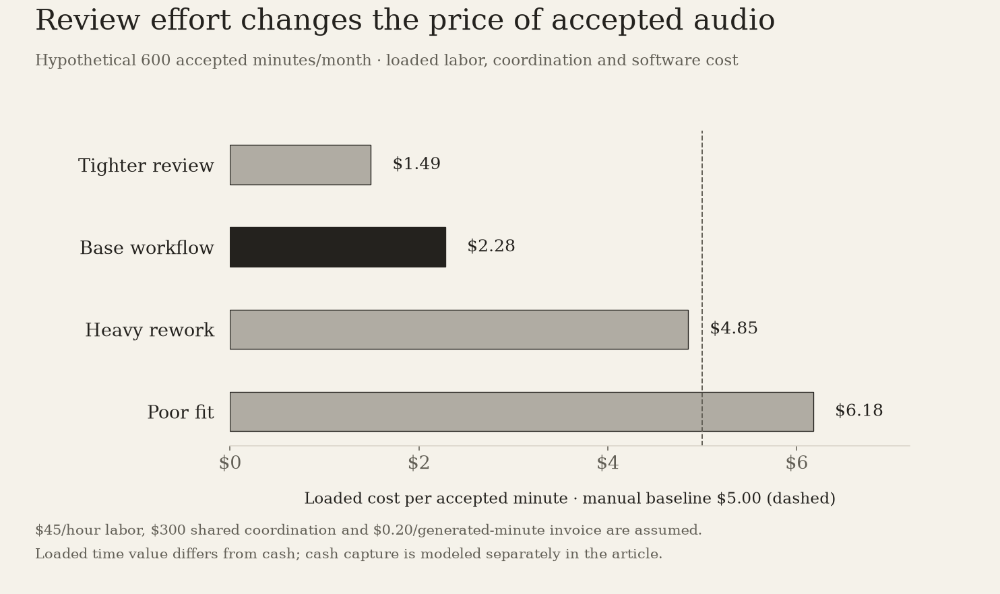
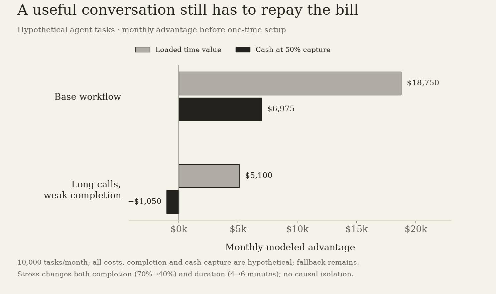

# ElevenLabs: What a Finished Minute Is Worth

A voice demo is the opening. I model the review, fallback and cash capture needed to turn generated usage into work a customer renews.

A voice demo can be convincing before it does any useful work. The words sound natural, the pauses feel deliberate, and the speaker seems to understand the sentence. The commercial question begins when someone tries to publish that sentence, put it in a training course, or let it handle a customer request. What did it cost to get an acceptable result, and will the customer pay for the next one?

I find ElevenLabs interesting because it can improve several parts of that process at once: the voice, the production tools, and the interaction with a customer's systems. My positive thesis is that those improvements can compound into a workflow people renew. My reservation is that generated usage can expand while the cost of accepted work remains disappointing. I would judge the business through that gap.

## The dated checkpoints

The company reported exceeding $500 million of ARR in the first four months of 2026. Its September 30 announcement then described a $300 million employee tender at a $22 billion valuation, enterprise customers providing 55% of revenue, and more than 15 million agent conversations each week. These are different measures from different dates. They show commercial scale; they do not tell me current overall ARR, successful task completion or gross profit. [ARR announcement](https://elevenlabs.io/blog/500m-arr-and-new-investors), [tender announcement](https://elevenlabs.io/blog/tender-22bn).

| Reported checkpoint | What I can use it for | What remains unresolved |
| --- | --- | --- |
| More than $500m ARR during January–April 2026 | Dated evidence of commercial demand | Current ARR, methodology and recognized revenue |
| $22bn September tender benchmark | The scale of expectations attached to the business | Price and rights of a particular security |
| More than 15m weekly agent conversations | Evidence of throughput | Unique tasks, accepted outcomes and buyer cash savings |

I would not pair April's denominator with September's valuation and call the result a current revenue multiple. Nor would I treat an employee tender as money raised to fund operations. The investing question needs current operating evidence and the terms of the actual security. The operating question can be investigated now, without pretending those missing pieces are known.

## The product unit and the customer's unit differ

ElevenLabs meters production in ways that depend on the product, model, plan and route. Its pricing page distinguishes model-specific character costs; documentation describes conditional free website regenerations and a different treatment through the API. The v3 website flow, for example, supplies two alternatives for one billed generation. Those mechanics matter when reconciling a workload, but they do not create a universal exchange rate between credits and accepted minutes. [Pricing](https://elevenlabs.io/pricing), [credit explanation](https://elevenlabs.io/docs/help-center/account/general/have-characters-changed), [generation quota](https://elevenlabs.io/docs/help-center/account/general/do-i-use-quota-on-every-generation).

A narration team buys something more specific: a finished segment with correct pronunciation, timing, emphasis and permission to use the voice. One segment may need several attempts. Another may be accepted immediately. The script can change after review. A character count misses those differences, and a downloaded file need not be the version eventually published.

I would preserve both units. The invoice needs the actual billing meter, including subscription allocation, overages and any voice-specific multiplier. The production ledger needs generated duration, accepted duration and human effort. Joining the two makes cost per accepted minute inspectable. It also stops an attractive headline price from absorbing unlimited rework for free.

That distinction gives model quality a financial meaning. A better voice can reduce the number of attempts or the time spent correcting them. A cheaper generation can still be a worse purchase if approval becomes harder. The outcome I care about is the total effort needed to deliver the same acceptable work.

## Put review effort beside the software bill

Consider a hypothetical team producing 600 accepted minutes each month. Its existing process takes six human work minutes per finished minute, valued at $45 an hour. That includes production and approval. I leave $300 of monthly editorial coordination in both workflows, so the manual baseline costs $3,000. Demand and the standard of acceptance remain fixed.

For the AI workflow, I assume an effective invoice of $0.20 per generated minute. This is my modeling parameter, not ElevenLabs list pricing or a conversion from its credit allowance. It represents the workload's complete allocated software bill. In a real deployment I would obtain that amount from invoices and measured audio, reconciling any free alternatives separately.

The base case generates 1.4 minutes for each accepted minute and requires two human work minutes per accepted minute. The software costs $168 a month. Human work costs $900; coordination still costs $300. The loaded workflow therefore costs $1,368, or $2.28 per accepted minute, against the manual baseline's $5.00.

| Hypothetical audio workflow | Generated / accepted minutes | Human minutes per accepted minute | Loaded cost per accepted minute | Monthly time-value advantage | First-year cash benefit at 50% capture |
| --- | ---: | ---: | ---: | ---: | ---: |
| Tighter review | 1.2× | 1.0 | $1.49 | $2,106 | $10,572 |
| Base workflow | 1.4× | 2.0 | $2.28 | $1,632 | $7,584 |
| Heavy rework | 3.0× | 5.0 | $4.85 | $90 | −$2,820 |
| Poor fit | 4.0× | 6.5 | $6.18 | −$705 | −$9,660 |

Every operating number in this table is an assumption. Loaded cost prices human time; it is not a measured cash saving. First-year cash benefit assumes that half of positive labor relief actually removes a cost or avoids a paid hire, deducts the full software invoice, and deducts $1,200 of setup. Any additional labor in the poor-fit case is charged fully. No revenue uplift is credited.

In the base case, forty hours become available each month. At the assumed labor rate that capacity is worth $1,800 before software. Capturing half as cash leaves $900; paying the $168 invoice leaves $732. Across twelve months, after setup, the modeled cash benefit is $7,584. Renewal produces $8,784 if workload, quality and capture remain the same.

Heavy rework nearly matches the old process on loaded cost, yet loses cash under the same capture assumption. Ten hours become available, worth $450. Half becomes $225 of cash relief, against a $360 invoice. That is a $135 monthly deficit before setup. The apparent efficiency gain is too small to fund the bill.

This is why I would start with a bounded production job whose approvals can be measured. A useful pilot should tell me which work became easier and which work moved into correction. A team that keeps its payroll unchanged may still gain capacity and publish more. That can be valuable, but the additional output needs its own demand and contribution evidence before I book it as income.

Hypothetical 600 accepted minutes per month. Review/rework changes the loaded cost; $45/hour labor, $300 shared coordination and a $0.20 generated-minute invoice are assumed. The invoice is not ElevenLabs pricing. Loaded time value differs from cash savings.

## Agents make the acceptance problem larger

The company's enterprise mix makes agent economics central to my thesis. A support conversation can sound excellent and still leave the customer's problem unresolved. It can also complete a valuable action with very little human involvement. The difference matters more than whether the voice wins a listening comparison.

ElevenAgents' current pricing page bills call minutes and identifies additional LLM costs and external telephony charges. The visible marginal call-minute price is only one component of a deployment. I would include the selected model, carrier, plan minimum, burst usage and ongoing oversight before calculating savings. [Agents pricing](https://elevenlabs.io/pricing/agents).

For a second hypothetical workload, assume 10,000 eligible unique tasks per month. The manual baseline takes five minutes per task at the same $45 hourly labor cost: $37,500 monthly. Each task gets one agent attempt. Every failed attempt then requires the full five minutes of human work; I give the agent no partial-saving credit on those cases.

I assume a $0.12 all-in invoice per call minute, four minutes per attempt in the base case, and sixty monthly hours of oversight. These are scenario parameters, including model and carrier costs, rather than an enterprise quote. The base completion assumption is 70%: a verified action in the underlying system, no human fallback, and no repeat contact for the issue within a hypothetical seven-day window.

That leaves 3,000 human fallbacks. Their labor costs $11,250, oversight costs $2,700, and the agent invoice costs $4,800. The loaded workflow costs $18,750, half the manual baseline. But the same 50% cash-capture assumption changes the renewal benefit to $6,975 per month. After a hypothetical $12,000 setup, first-year cash benefit is $71,700.

| Hypothetical agent workflow | Verified completion | Minutes per attempt | Monthly time-value advantage | Monthly cash benefit at 50% capture | First-year cash benefit |
| --- | ---: | ---: | ---: | ---: | ---: |
| Strong completion | 90% | 4 | $26,250 | $10,725 | $116,700 |
| Base workflow | 70% | 4 | $18,750 | $6,975 | $71,700 |
| Long calls, weak completion | 40% | 6 | $5,100 | −$1,050 | −$24,600 |

All figures are modeled. Every attempted call is paid; fallback and oversight remain in the calculation. It excludes customer waiting cost and losses from harmful or undetected errors. Such failures cannot be reclassified as successful tasks merely because their consequences are absent from the table.

The stress case still shows a positive loaded time-value advantage. It fails on cash because long calls consume $7,200 of invoices while half the $12,300 labor relief supplies only $6,150. Longer conversations and weaker completion can therefore turn apparently successful automation into an ongoing budget problem.

Under the four-minute assumptions, recurring cash breaks even at 32.8% verified completion. With six-minute attempts, that requirement rises to 45.6%. These are financial thresholds, not acceptable service-quality targets. They show how billing duration, completion and labor capture interact; they do not authorize a deployment that produces unreliable actions or makes customers repeat themselves.

Hypothetical 10,000 tasks per month. The stress case changes both completion and duration; it is not a causal isolation. Every attempted call, human fallback and oversight remain in the calculation. Cash captures half of positive labor relief, and one-time setup is excluded from the monthly comparison.

## A transcript is evidence, not the final receipt

ElevenLabs provides custom success evaluation: an LLM assesses a conversation transcript against chosen criteria and returns success, failure or unknown with a rationale. I see that as a useful analysis feature. I would still reconcile the assessment with the business event it describes. [Success evaluation](https://elevenlabs.io/docs/eleven-agents/customization/agent-analysis/success-evaluation).

For a booking task, the receipt is an appointment in the scheduling system. For a refund, it is the authorized transaction. For an account issue, it includes whether the same problem returns. “The agent said it was done” and “the task was done” can be different observations. Counting unknown cases as successes would make the economic denominator look better precisely when verification is weakest.

I would compare tasks with comparable tasks, using eligibility decided before routing. Sending easy cases to the agent and difficult cases to humans can be a sensible operating choice. It does not establish that the agent is faster or cheaper across the whole support queue. The useful claim is narrower: this class of work, at this quality level, produced these verified results for this complete cost.

That gives a customer a practical renewal argument. It also gives ElevenLabs a way to demonstrate value that survives changing benchmarks. A buyer can accept a higher software bill if accepted outcomes improve enough. The evidence must show the outcome and the remaining human workload together.

## The moat I would want is accumulated production knowledge

An enduring voice-quality lead would help. I would be more interested in a product that learns how a customer approves and deploys work: which pronunciations are correct, which voices fit a brand, which actions require permission, and which corrections prevent the next rejected result. Those improvements can reduce accepted-unit cost even when another provider offers competitive generation.

This advantage depends on execution and rights. Customer-specific information is not automatically reusable training material. A recognizable voice is not automatically permanent supply. The Voice Library documents owner-selected withdrawal notice periods; the payouts system rewards shared voices and links payout rates to those choices. Brand continuity and voice supply belong in the commercial analysis. [Voice Library](https://elevenlabs.io/docs/eleven-creative/voices/voice-library), [payouts](https://elevenlabs.io/docs/eleven-creative/voices/payouts).

A production team that has built approved voices, pronunciation conventions and review procedures may find switching costly. The defensible version of that friction is a workflow that consistently delivers better work. Friction from uncertainty about availability or migration can instead damage the relationship. I would look for customers that expand after operating through those issues, not just after a successful demonstration.

Distribution matters just as much. An API can reach developers building many applications; a finished production tool can reach teams that lack those developers; an agent platform can own a recurring service workflow. Each route has a different acquisition cost, support burden and exposure to another vendor's product decisions. I would want retention and contribution by route before treating them as one uniformly attractive revenue stream.

## The strongest countercase is a cheaper route to the same outcome

A competing model does not have to be better at every voice. It needs to deliver acceptable work for the buyer's particular job. If a customer keeps its prompts, business logic and approval process outside ElevenLabs, it can test replacement models against a stable workflow. Lower generation prices then have a clearer path into bargaining pressure.

A broader software vendor could also bundle voice into the tool where a buyer already edits media or manages customer support. That removes a separate purchasing decision and may reduce integration effort. ElevenLabs must justify the incremental contract through quality, completion, deployment speed or total cost. An excellent standalone product can face that pressure without losing its technical capability.

The opposite case is compelling too. If ownership of models and workflow lets ElevenLabs remove rerenders, shorten calls and handle difficult interactions more reliably, the buyer may save far more in human effort than it spends on software. My audio model makes that visible: review changes are worth much more than small differences in a per-generation price. The company could keep meaningful pricing power by improving the expensive part of the customer's process.

## Customer value must reach company contribution

Positive buyer economics are necessary evidence for this thesis, but they do not tell me ElevenLabs' delivery margin. Revenue has to fund inference, any applicable voice or licensing payouts, customer-specific deployment and ongoing service. Selling, research and administration then require funding too. The reviewed sources do not disclose a complete cost bridge or audited margins, so I leave those quantities unknown.

There is also an incentive tension. Additional billed attempts can increase usage revenue today while raising the customer's accepted-unit cost. Eliminating bad attempts may reduce immediate usage but improve retention and allow more useful work. I would favor a business whose expansion comes from more accepted work, rather than customers repeatedly paying to fix the same output.

What would change my judgment is concrete: cohorts that renew after actual usage is understood; accepted-audio cost falling at a stable quality standard; verified task completion improving without hidden human work; and contribution that remains attractive as deployments grow. I would want those measures by product and acquisition route, with the difficult workloads still visible.

I like the direction of the business. Voice can become part of production and service infrastructure, and ElevenLabs has reported meaningful commercial demand. At the tender's $22 billion benchmark, I need the workflow advantage to produce durable customer value and company earnings. A finished minute and a verified task provide a firmer starting point for that judgment than an impressive sample I can play once.

## Scope

Primary evidence verified October 13, 2026. May ARR and September employee tender are distinct dated checkpoints; no current multiple or security price is inferred. All audio/agent operating parameters and invoices are hypothetical. Generated minutes are measured audio, not credits converted to accepted minutes. Time value, cash savings and unknown company costs remain distinct.

## Sources

- [ElevenLabs crosses $500M ARR and welcomes new investors](https://elevenlabs.io/blog/500m-arr-and-new-investors) — ElevenLabs, 2026-05-05; verified 2026-10-13. Company reports surpassing $500m ARR during the first four months of 2026. Page updated September 20. Historical checkpoint, no disclosed ARR methodology or audited revenue/gross-profit reconciliation.
- [ElevenLabs reaches $22bn valuation after employee tender](https://elevenlabs.io/blog/tender-22bn) — ElevenLabs, 2026-09-30; verified 2026-10-13. Updated October 5. Reports a recently closed $300m employee tender at $22bn valuation, enterprise share of revenue of 55%, and more than 15m weekly agent conversations. Throughput is not verified task resolution. Exact security rights, current overall ARR and audited margins are not established.
- [ElevenLabs pricing and billing mechanics](https://elevenlabs.io/pricing) — ElevenLabs, Current documentation; verified 2026-10-13. Living page with model/product-specific credit costs, paid plan allowances, regeneration qualifications and annual billing. Visible promotion banners and allowances are not treated as durable output prices. No credits-to-finished-minutes conversion is inferred.
- [Have characters changed?](https://elevenlabs.io/docs/help-center/account/general/have-characters-changed) — ElevenLabs Documentation, Current documentation; verified 2026-10-13. Explains credit terminology, website text-to-speech character billing, discounted API usage and custom voice multipliers. General explanation must be reconciled with selected model and current pricing; no universal conversion or output quality claim.
- [Do I use quota on every generation?](https://elevenlabs.io/docs/help-center/account/general/do-i-use-quota-on-every-generation) — ElevenLabs Documentation, Current documentation; verified 2026-10-13. Generation consumes quota; limited website regenerations have conditions, API does not receive the same free-regeneration entitlement, and the v3 website flow produces two alternatives per billed click. Not assumed to describe every newer model.
- [Voice Library payouts](https://elevenlabs.io/docs/eleven-creative/voices/payouts) — ElevenLabs Documentation, Current documentation; verified 2026-10-13. Documents rewards for shared voices and payout-rate relationship to selected withdrawal notice period. Aggregate voice royalty burden, licensed-voice contract costs and unit gross margins remain unknown.
- [ElevenAgents pricing](https://elevenlabs.io/pricing/agents) — ElevenLabs, Current documentation; verified 2026-10-13. FAQ states call-minute billing and separate LLM usage plus direct external telephony-provider bills. Standard additional call minutes listed at $0.08; burst is higher. The article does not turn this marginal quote into a complete enterprise invoice or company COGS.
- [Success evaluation for ElevenAgents](https://elevenlabs.io/docs/eleven-agents/customization/agent-analysis/success-evaluation) — ElevenLabs Documentation, Current documentation; verified 2026-10-13. Custom transcript evaluation uses LLM-powered analysis and returns success, failure or unknown with rationale. It is an analysis feature, not independent proof that a business-system action succeeded or that repeat contact was avoided.
- [Voice Library availability and custom rates](https://elevenlabs.io/docs/eleven-creative/voices/voice-library) — ElevenLabs Documentation, Current documentation; verified 2026-10-13. Documents voice-owner withdrawal notice periods, legacy custom rates and plan-sensitive credit multipliers. A saved voice is not assumed to be permanent or exclusive.
