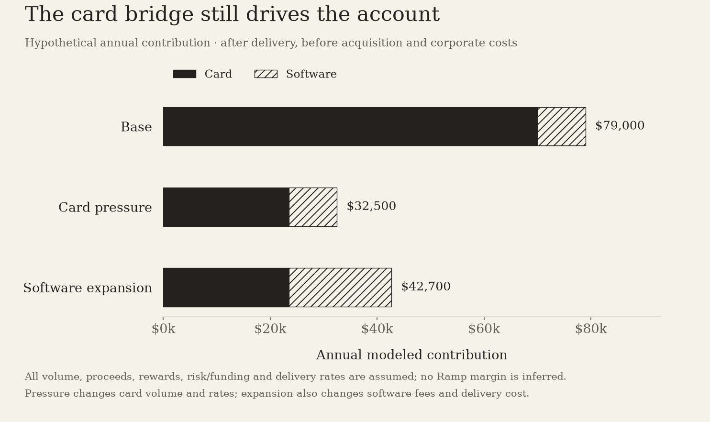

# Ramp: Saving the Customer Money Has to Improve the Business

I separate the card bridge from paid workflow value, then test whether the platform and its buyer keep enough of the benefit.

Ramp's promise creates an interesting tension: it helps customers control spending while part of its economics depends on spending passing through its platform. I like that tension when better control earns a larger share of a customer's workflow. I become cautious when routed volume is doing the work that a durable, profitable relationship should do.

My thesis is that Ramp can become valuable financial infrastructure if customers keep paying for controls, automation and dependable execution after the initial card decision. I would evaluate that thesis through contribution by product and retained customer cohort. A larger payment number or a higher private financing mark answers a different question.

## The card opens a relationship with several revenue streams

The [June 4, 2026 financing release hosted by GIC](https://www.gic.com.sg/uploads/2026/06/Ramp-Raises-Series-F-at-44-Billion-Valuation-3.pdf) announces a $750 million primary financing at a $44 billion valuation. Its June 1 company statistics include more than $1 billion in annualized revenue, positive free cash flow and more than seventy thousand customers. These are dated company claims. Annualized revenue is not disclosed subscription ARR, and the release is not a set of audited financial statements.

I would resist turning that revenue figure into a software multiple before understanding its components. Card proceeds, software fees and payment-service fees can have different delivery costs, customer incentives and economic risks. Even a consistent revenue total can change its meaning as the mix changes. The useful comparison is the cash or contribution retained from those activities on a consistent basis.

Ramp itself points toward that distinction. Its [November 17, 2025 company post](https://ramp.com/blog/ramp-november-2025-valuation) identifies the profitability measure discussed there as contribution profit. The post does not supply the complete line-by-line reconciliation I would need to reproduce company earnings. I treat the label as a signal about management's focus, then keep my own illustrative bridge separate from that reported measure.

The commercial logic is promising. A card creates frequent transactions and an opportunity to manage receipts, approvals and accounting. A customer that trusts the execution may use more of the workflow. I would then ask which new activities earn incremental contribution and which mainly support the existing card relationship. Counting every enabled feature as a separate revenue engine would exaggerate the result.

## A dollar of volume is not a dollar of retained economics

I use one hypothetical business account to make the distinction inspectable. It routes $12 million of annual card purchases and pays $12,000 in annual software fees. All platform rates and delivery costs below are assumptions. They are neither Ramp's interchange rates nor estimates of its reported margins.

In the model, the platform receives card proceeds equal to 2.2% of volume after partner/network sharing and before customer rewards. Rewards consume an assumed 1.2% of volume; risk and funding consume another 0.35%. The remaining 0.65% is $78,000. After an $8,000 account-delivery allowance, card contribution is $70,000. The software fees leave $9,000 after an assumed 25% delivery cost, for $79,000 combined annual contribution.

That bridge is deliberately narrower than company profit. It excludes acquisition, shared engineering, corporate overhead, tax and capital needs. The proceeds convention also avoids presenting an illustrative platform receipt as a merchant fee or GAAP gross revenue. A real financial reconciliation would need the actual revenue-recognition policy and the contractual allocation among the participants.

**Hypothetical annual contribution from one account**

| Input or result | Base | Card pressure | Software expansion |
| --- | --- | --- | --- |
| Card volume | $12,000,000 | $9,000,000 | $9,000,000 |
| Card proceeds to platform / volume | 2.20% | 2.00% | 2.00% |
| Customer reward cost / volume | 1.20% | 1.20% | 1.20% |
| Risk and funding / volume | 0.35% | 0.45% | 0.45% |
| Retained card contribution after account delivery | $70,000 | $23,500 | $23,500 |
| Annual software fees | $12,000 | $12,000 | $24,000 |
| Software contribution after modeled delivery | $9,000 | $9,000 | $19,200 |
| Combined contribution before acquisition/corporate costs | $79,000 | $32,500 | $42,700 |

The pressure case assumes 25% less card volume, lower proceeds and higher risk/funding costs. The expansion case retains those card assumptions, doubles software fees and changes software delivery cost from 25% to 20%. These are deterministic examples, not forecasts, probabilities or observed customer cohorts.

Hypothetical annual contribution from one account after card and software delivery, before acquisition and corporate costs. The card-pressure case changes volume and rates; software expansion also changes fees and delivery cost. All platform inputs are assumed; no Ramp margin is inferred.

The pressure case loses $46,500 of annual contribution relative to the base. Doubling the software bill and improving its assumed delivery efficiency adds $10,200 back. That is helpful diversification, but the original contribution still depends heavily on the card bridge. I would want the real product mix to demonstrate how much pressure paid workflows can absorb.

## Saving money can still strengthen the relationship

There is no necessary contradiction between helping a customer spend less and earning more over time. A customer can eliminate waste while moving more of its remaining purchases onto one platform. Better controls could also improve retention, reduce support work or make paid automation more attractive. Those channels can outweigh the lost volume from a successful savings intervention.

They need to be measured separately. In the base illustration, avoiding $100,000 of purchases reduces retained card proceeds by $650 before any other behavior changes. If the intervention secures a renewal, increases useful workflow adoption or lowers the cost of winning that account, it could be excellent business. Simply reporting the avoided spend would not show the platform benefit.

The opposite case is also possible. The customer may keep the free controls, move large payments to another rail and decline the paid workflow. Ramp might still provide a useful service while capturing less economic value. I would examine contribution retention alongside customer retention, because an account that stays can change its volume, mix and cost enough to weaken the cohort.

I would also separate avoided spending from better buying. Removing unused software can generate a fairly direct reduction in a bill. Negotiating better terms, preventing an out-of-policy purchase or changing payment timing may require different comparisons. A savings total that mixes them can be useful for a customer conversation while remaining too broad for an investment model.

## The paid tier has to earn an incremental budget

The [current public pricing page](https://ramp.com/pricing) lists Ramp Plus at $15 per user per month, plus a platform fee based on team size; it also advertises an annual-billing discount. I use the monthly list rate in a full-year hypothetical buyer case and assume the platform fee separately. This is an illustrative budget, not a quote for a real account.

The case compares the paid workflow with the customer's previous or free workflow. It does not credit the paid tier for card rewards or controls the customer already had. That baseline is decisive: a product can generate impressive overall customer value while an incremental paid upgrade still fails to pay for itself.

Assume sixty paid seats, a $4,200 annual platform fee and $8,000 of first-year implementation. The annual software bill is $15,000: $10,800 of seats plus the assumed platform fee. Six recovered finance-team hours a week over forty-six weeks release 276 hours. At an assumed $60 per hour and 50% cash capture, they avoid $8,280 of spending.

That leaves the paid tier dependent on an additional benefit. I assume $20,000 of genuinely incremental avoided purchases in the base. First-year net benefit is $5,280; renewal benefit is $13,280 when implementation drops out. If only $5,000 of the supposed savings is incremental, the first year loses $9,720 and renewal loses $1,720.

**Hypothetical incremental buyer economics**

| Annual or first-year item | Base savings | Weak incrementality |
| --- | --- | --- |
| Annual software bill | $15,000 | $15,000 |
| Captured labor cash | $8,280 | $8,280 |
| Incremental avoided purchases | $20,000 | $5,000 |
| First-year implementation | $8,000 | $8,000 |
| First-year net benefit | $5,280 | −$9,720 |
| Recurring net benefit | $13,280 | −$1,720 |

Seat count, hours, cash capture, platform fee, implementation and avoided purchases are assumed. Taxes, payment-method fees and the annual-billing discount are excluded. Unchanged rewards and free-tier benefits are excluded from the incremental comparison.

The first-year hurdle is $14,720 of incremental avoided purchases after the assumed labor cash. Renewal needs $6,720. These thresholds give a finance team something useful to investigate: which reductions require the paid workflow, and which would have happened through normal budgeting anyway? A renewal grounded in that comparison is stronger evidence than a dashboard with a large aggregate savings number.

## Rewards and payment methods need their own ledger

I would not assume one cashback percentage applies to every customer and transaction. Ramp's [Rewards Terms updated September 22, 2026](https://ramp.com/legal/customer-terms/services-terms/rewards-terms) describe eligibility, qualified purchases, rates set by Ramp and redemption conditions. The hypothetical 1.2% expense in my platform case is a modeling choice. It is not a claim about a universal current offer or the accounting treatment of every reward.

This matters because incentives can change retained economics without an obvious change in payment volume. A richer offer can win more purchases and leave less contribution per dollar. A different customer mix can carry different servicing or risk costs. I would want rewards reconciled to the accounts and purchases that generated the proceeds, including reversals or ineligible activity where material.

Payment rails add another layer. A transaction that leaves the card can still create customer value through accounts payable, but it may carry a different fee and cost structure. I would therefore trace the route of the payment, not merely celebrate a larger platform-volume figure. A workflow with lower payment contribution could remain attractive if customers pay enough for the controls around it.

The operational promise also grows with the number of routes. A buyer expects payments, approvals and accounting records to stay consistent. Exceptions, failed reconciliations and support incidents can consume the margin of a seemingly automated workflow. I would examine the exception rate and its actual servicing cost, rather than treat every task handled by software as a costless task.

## AI spend management could deepen the budget relationship

Ramp's [June 4, 2026 strategy post](https://ramp.com/blog/ramp-at-44-billion-the-third-pillar) describes tools for viewing AI usage and cost, assigning spend to teams or use cases, and controlling it. I see a sensible extension of the existing finance job. A customer buying metered intelligence still needs to decide who may spend, what work the spend supports and when an exception should be reviewed.

The valuable layer could be the connection between usage and the company's financial workflow. A separate usage dashboard may explain a model bill; a finance system can connect that bill to an owner, approval and budget. If that connection saves recurring work and improves decisions, it could justify a durable paid relationship.

I would be more cautious about pricing the business on promises that the product can identify the best model for every task. Useful routing depends on the task, acceptable quality and the cost of failure. An inexpensive generation that needs extensive repair can cost more than a dearer one that produces accepted work. The savings claim should follow the completed workflow, not just the token meter.

This gives the paid tier another measurable opportunity. I would test whether teams using the controls achieve lower spending per accepted business result while maintaining quality and governance. That could support software fees even if the customer buys fewer tokens or pays an AI vendor through a different rail. The value would then sit in the decision and operating system, not only in routing the payment.

## The strongest case against my caution

The strongest bullish argument is that Ramp already has the distribution to make each additional workflow economical. A broad existing customer base, frequent transaction activity and familiar approval/accounting records can give new products a shorter route to adoption than a standalone tool would have. Several individually modest contribution streams could become a strong relationship in combination.

That argument would make my static account model conservative. It includes no lower acquisition cost from referrals, no improvement in customer retention from a better product and no growth in volume from winning more of the customer's wallet. A customer could spend less in total while generating more contribution for Ramp through a deeper relationship.

I would accept that countercase with consistent cohorts. The useful evidence would show the same customers adopting additional products, producing more retained contribution after incentives and delivery costs, and requiring less incremental sales effort. A comparison that puts newer enterprise customers beside older small accounts would not isolate the expansion mechanism.

The competitive counterargument remains meaningful. Finance teams may already use an ERP, a bank, a procurement system and specialist tools. Winning a card decision does not grant permanent ownership of all those budgets. Ramp has to make the broader workflow dependable enough to replace or coordinate the alternatives at a cost the customer can defend.

## The financing mark raises the standard for evidence

The $44 billion June financing is a useful statement about a transaction, not an observable common-share price available on identical terms. I would need the security rights, dilution path, capital requirements and a coherent cash or contribution forecast to assess a particular investment. My account illustrations do not supply those missing terms or scale mechanically into a company valuation.

The operating evidence I would ask for is more concrete: contribution retained by product, net contribution retention of established accounts, acquisition payback including incentives, and the relationship between reported free cash flow and payment working capital. Period-end cash can benefit from collection timing while the underlying economic obligations continue. A cash-flow claim without the bridge leaves that distinction unresolved.

My judgment is positive on the workflow opportunity and demanding on the economics. Ramp can earn a larger role by making a customer's spending more deliberate and its finance operations less expensive. I would get more interested as paid-workflow contribution and retained customer cash make the business less dependent on a favorable card bridge. That is the progress I would want to see behind the next headline valuation.

## Scope

Primary company evidence verified October 13, 2026. Financing and annualized revenue are dated June 2026 checkpoints, not subscription ARR, audited financials or current common-share prices. All platform account economics are hypothetical. Buyer comparison is incremental to the previous/free workflow; seat price is a dated monthly-list analogue and other assumptions are authored.

## Sources

- [June 2026 primary financing and company statistics](https://www.gic.com.sg/uploads/2026/06/Ramp-Raises-Series-F-at-44-Billion-Valuation-3.pdf) — Ramp / GIC, 2026-06-04; verified 2026-10-13. Announces a $750m primary financing at $44bn. June 1 company statistics: over $1bn annualized revenue, positive free cash flow and over 70,000 customers. Annualized revenue is not subscription ARR; audited statements and security terms are not supplied.
- [Contribution-profit terminology in November company post](https://ramp.com/blog/ramp-november-2025-valuation) — Ramp, 2025-11-17; verified 2026-10-13. The post identifies underlying profitability as contribution profit. It gives no complete line-by-line reconciliation. Modeled account contributions are separate from the company measure.
- [Current free/Plus/Enterprise pricing](https://ramp.com/pricing) — Ramp, 2026-10-13; verified 2026-10-13. Plus is $15 per user per month plus a platform fee based on team size, with a 20% annual-billing discount advertised. The buyer model uses monthly list pricing; its platform fee is assumed, and the discount and payment-method fees are excluded.
- [Rewards Terms](https://ramp.com/legal/customer-terms/services-terms/rewards-terms) — Ramp, 2026-09-22; verified 2026-10-13. Qualified purchases, Ramp-set rates, eligibility and redemption conditions. These terms establish no universal cashback rate. The modeled 1.2% reward expense is hypothetical.
- [AI token-spend management strategy](https://ramp.com/blog/ramp-at-44-billion-the-third-pillar) — Ramp, 2026-06-04; verified 2026-10-13. Describes tools to view AI usage and cost, assign it to teams or use cases, and control spending. Promotional economic or model-quality claims are not treated as independent causal evidence.
