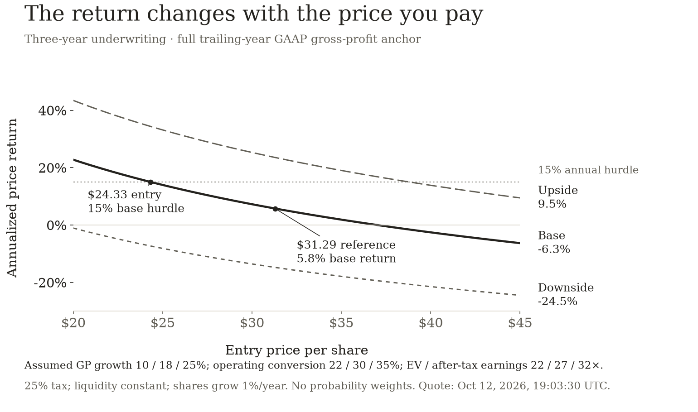

# Toast: I Want the Gross-Profit Engine at a Better Price

I like the workflow and the operating leverage. A full seasonal-year model puts the entry hurdle well below the dated market quote.

I am interested in Toast because the same operating workflow can support two businesses: software a restaurant pays to use, and payments processed as the restaurant serves customers. A useful system can earn subscription revenue, remain close to the transaction, and spread its operating costs across a larger installed base.

The stock requires a separate judgment. My three-year base case produces about $37 per share, but only a 5.8% annualized return from the $31.29 reference quote I captured on October 12, 2026. To earn a 15% annualized return from that same case, I would want an entry around $24. I like the operating mechanism more than the return available at the reference price.

That gap makes Toast a price-dependent pitch. I would look for an entry near the hurdle, or evidence that gross profit and operating conversion can do more than my base case assumes. I would not pay for the upside case merely because the product has become more capable.

## Follow the dollar that stays with Toast

Toast's Q2 2026 revenue was $1.908 billion. The reported total is a poor starting point for comparing its economics with a software company. Much of payments revenue pays transaction-related costs before Toast can spend anything on product development, selling, or administration.

The cleaner bridge begins with the two recurring streams. Subscription revenue of $290 million, less $64 million of cost, produced $226 million of gross profit. Financial-technology revenue of $1.570 billion, less $1.211 billion of cost, produced $359 million. Together, they produced $585 million. Hardware and professional services lost $68 million at the gross-profit level; another $1 million of acquired-intangible amortization brought total gross profit to $516 million. These are GAAP figures from the [Q2 statements](https://www.sec.gov/Archives/edgar/data/1650164/000165016426000162/tost-20260630xexhibit991.htm).

**Q2 2026: revenue to gross profit**

| Stream | Revenue | Cost of revenue | Gross profit |
| --- | --- | --- | --- |
| Subscription | $290m | $64m | $226m |
| Financial technology | $1,570m | $1,211m | $359m |
| Recurring-stream subtotal | $1,860m | $1,275m | $585m |
| Hardware / professional services | $48m | $116m | −$68m |
| Acquired-intangible amortization | — | $1m | −$1m |
| Company total | $1,908m | $1,392m | $516m |

Reported GAAP USD millions, unaudited quarter. Fintech includes $302m of payments and $57m of non-payment gross profit; do not treat all fintech income as payments yield. Source: Q2 release and reconciliation.

This bridge tells me where to look for operating leverage. The software and payments streams can grow while sales, engineering, and administration grow more slowly. Hardware and installation can also consume some of that benefit. A model that values only the attractive recurring streams and leaves deployment costs outside the company would overstate the economics.

Toast also reports annualized recurring run-rate, or ARR. Its definition combines subscription billings with adjusted payment fees after estimated transaction costs. It excludes Toast Capital fees and is not reduced by SaaS credits. I therefore would not apply a pure-software revenue multiple to the headline ARR and treat the result as a clean comparison. The recurring streams differ in margin, cyclicality, and the work needed to acquire them. The [filing's metric definition](https://www.sec.gov/Archives/edgar/data/1650164/000165016426000164/tost-20260630.htm) makes that distinction explicit.

## The workflow is the attraction

A payment processor earns more when its customers transact more. A software vendor can earn more when customers adopt another useful workflow. Toast can pursue both, within an operating system that is already involved in taking orders and serving guests. My positive thesis is that this proximity gives the company repeated opportunities to improve the customer's business and capture a portion of the benefit.

The strongest version of that thesis involves useful expansion after installation. A restaurant that initially buys a point-of-sale system can later find value in another workflow without replacing its core system. Existing distribution can lower the incremental effort of selling that next product. The improvement still has to be worth paying for; access to a customer does not guarantee adoption.

The current scale gives that possibility substance. Toast reported approximately 180,000 locations, up 22% year over year, and $60.7 billion of quarterly gross payment volume, also up 22%. GAAP subscription and financial-technology gross profit rose 31%. Gross-profit growth exceeded location growth, but the aggregate comparison does not establish same-location expansion. New locations, mix, product adoption, and payment economics can all contribute. [Q2 earnings release](https://www.sec.gov/Archives/edgar/data/1650164/000165016426000162/tost-20260630xexhibit991.htm).

The $359 million includes non-payment fintech income. Toast separately reports $302 million of payment gross profit, which divided by $60.7 billion of volume gives roughly 50 basis points. That is a gross-profit yield on aggregate processed volume, not the merchant's processing price. I would watch that yield separately from non-payment income and credit losses. More volume creates value only if enough economics remain after processing costs. [Payment gross-profit reconciliation](https://investors.toasttab.com/financials/quarterly-results/default.aspx).

I am also careful with the location denominator. Toast's location definition includes selected enterprise sites that do not use its payment services. Dividing all payments economics by all locations cannot produce a clean payments profit per processing location. A useful unit model needs the population that actually generates the numerator.

## The acquisition bill is still there

The uncomfortable part of the thesis is the cost of putting a physical business onto the platform. A restaurant needs working equipment, reliable implementation, and support when service is underway. Those obligations help explain why installation and hardware can carry losses even when the recurring streams look attractive.

The investment question is whether those losses buy sufficiently durable future gross profit. I would want to see acquisition economics by location cohort: cash spent to win and install it, recurring gross profit after installation, closure or churn, and expansion. A growth rate cannot tell me whether the newest cohort repays its cost as well as the earlier ones did.

Accounting timing adds another complication. Toast capitalized $93 million of contract acquisition costs in the first half of 2026 and amortized $46 million. The cash spent to obtain contracts therefore ran ahead of the expense recognized through that amortization line. This is not a reason to dismiss reported earnings; it is a reason to reconcile the earnings with the cash needed to keep adding customers.

The same reconciliation matters for hardware inventory. First-half operating cash flow was $276 million, and capital spending was $31 million, leaving $245 million under a simple operating-cash-flow-minus-capex definition. The comparable 2025 amount was $277 million. Inventory used $103 million of cash in the 2026 half. Stronger net income has not yet produced stronger first-half free cash flow. [Cash-flow statement and contract-cost note](https://www.sec.gov/Archives/edgar/data/1650164/000165016426000164/tost-20260630.htm).

I would not treat that inventory movement as a permanent annual expense or add it all back as harmless timing. The first assumes the business will keep building inventory at the same rate forever. The second assumes it will unwind without a problem. The next useful evidence is how inventory turns, deployment, acquisition spending, and cash collection behave together as growth continues.

## What I am paying for in the base case

I start with a full trailing seasonal year. GAAP subscription and fintech gross profit was $1.818 billion in 2025. Subtracting the first half of 2025's $841 million and adding the first half of 2026's $1.105 billion gives $2.082 billion for the twelve months through June. Four times Q2 would instead give $2.34 billion, overstating the starting engine by about 12%. [2025 annual results](https://www.sec.gov/Archives/edgar/data/1650164/000165016426000050/tost-20251231xexhibit991.htm), [current half-year statements](https://www.sec.gov/Archives/edgar/data/1650164/000165016426000164/tost-20260630.htm).

Trailing operating income is $431 million using the same annual-minus-old-half-plus-new-half bridge. That is 20.7% of recurring gross profit, compared with the stronger quarter's reported 26.0%. The base's future 30% conversion therefore requires real improvement over the full-year starting point. I would not describe that assumption as simply maintaining today's margin.

The three-year base case assumes 18% annual recurring-gross-profit growth. It then converts 30% of that gross profit into GAAP operating income after hardware losses and all operating expenses, including stock compensation. I tax that income at an assumed 25%, value the resulting after-tax operating earnings at 27 times, and add the June balance of $1.713 billion in cash and marketable securities. Customer cash and restricted cash are excluded; the revolving facility had no borrowings.

For the share denominator, I use Q2's 590 million diluted weighted-average shares as a proxy, then assume 1% annual growth. The proxy is not a point-in-time fully diluted cap table. I assume no dividends and keep eligible liquidity constant, so the model gives no additional credit for future cash accumulation or net share repurchases. Those are deliberate choices that can be replaced when a fuller capital-allocation forecast is available.

The calculation is: terminal recurring gross profit × operating conversion × 75% after tax × exit multiple, plus eligible liquidity, divided by terminal shares. The multiple applies to enterprise value and after-tax operating earnings. It is not a price-to-sales ratio or a quoted market comparable.

**Three-year underwriting from $2.082bn trailing recurring gross profit**

| Assumed path | GP growth / year | Operating conversion | Exit EV / after-tax operating earnings | Year 3 value / share |
| --- | --- | --- | --- | --- |
| Downside | 10.0% | 22.0% | 22× | $19.37 |
| Base | 18.0% | 30.0% | 27× | $37.00 |
| Upside | 25.0% | 35.0% | 32× | $59.01 |

Deterministic assumptions, no probabilities. 25% tax; $1.713bn eligible liquidity held constant; 590m diluted-share proxy grows 1% annually. Conversion includes all GAAP operating expenses and deployment losses. No extra future cash accumulation, dividends or buyback credit.

Underwriting curves derived from a $2.082bn trailing GAAP recurring-gross-profit anchor. All future growth, conversion, taxes, multiples and dilution are assumed. The curves have no probability weights or confidence-interval interpretation.

The base produces $37.00 per share at the end of the modeled three years. From the fixed $31.29 quote at 3:03:30 p.m. Eastern on October 12, that is a 5.8% annualized price return. The quote is a dated reference from [Google Finance](https://www.google.com/finance/quote/TOST:NYSE), and it will move. The valuation calculation remains usable by substituting a new entry price.

I do not assign probabilities to these cases. They are coordinated assumptions, with weaker growth paired with weaker conversion and a lower terminal multiple. The wide range is a statement about the thesis's dependence on the operating result and the price investors will pay for it. It is not a statistical confidence interval.

## A good company can leave a modest return

The base permits $24.33 of entry price to produce the 15% annualized hurdle. At $35, the same business outcome produces only 1.9% a year. That is why I want a price discipline alongside the operating thesis.

**The same base business outcome at different entry prices**

| Entry / share | Year 3 base value | Annualized price return |
| --- | --- | --- |
| $24.33 | $37.00 | 15.0% |
| $25.00 | $37.00 | 14.0% |
| $31.29 | $37.00 | 5.8% |
| $35.00 | $37.00 | 1.9% |
| $40.00 | $37.00 | -2.6% |

Three-year holding period, no dividends. The unrounded entry hurdle is used before display rounding. $31.29 is the dated October 12, 2026 reference quote, not a future live price.

Eighteen percent growth for three years is already a strong business outcome. So is converting 30% of recurring gross profit into GAAP operating income. If both occur and the terminal multiple remains generous, the stock can still deliver less than my hurdle from a higher starting price. The valuation is asking me to pay now for a considerable amount of the improvement.

The reported quarter also needs a little normalization. Q2 adjusted EBITDA of $221 million included a roughly $10 million one-time tariff refund. I would strip that benefit from a recurring EBITDA comparison rather than project it forward. I use GAAP operating conversion in the scenario model, and would check that future improvements come from recurring economics. [Earnings release and outlook](https://www.sec.gov/Archives/edgar/data/1650164/000165016426000162/tost-20260630xexhibit991.htm).

Buybacks can help per-share results, but the use of cash matters. Toast spent $486 million repurchasing shares during the first half. I would compare net diluted-share reduction with the cash spent and ongoing equity issuance. Repurchasing stock while granting stock compensation can still be sensible; it does not make the compensation or the cash expenditure disappear.

## The strongest case against my pitch

Toast could remain a capable product company while the stock disappoints. Its customers' transaction volumes are exposed to restaurant demand. New installations can become more expensive, and customers may resist additional charges. Competition can improve enough that keeping the core payment relationship requires concessions. In that situation, location growth may continue while the economics available to shareholders deteriorate.

The physical distribution model is also difficult to escape. Software expansion within an existing location might be efficient, but building the installed base still involves equipment, implementation, and sales. If the next set of customers is harder to reach or less durable, the recurring gross-profit engine can require more investment than the simple conversion assumption allows.

The bear should challenge my conversion and terminal multiple. The base assumes operating conversion improves from the trailing year's 20.7% to 30%, and that investors will still pay 27 times after-tax operating earnings at the end. A restaurant software business facing slower growth may not deserve that multiple. I would test those assumptions separately before allowing the word “platform” to settle either one.

## The evidence that would move my entry price

I would raise my willingness to pay if a full seasonal year showed recurring gross-profit growth comfortably above the modeled 18%, with healthy acquisition cohorts and cash conversion that did not depend on accumulating more inventory or extending the recovery of selling costs. I would want useful product expansion to contribute to that growth without a comparable increase in servicing effort.

I would lower it if payment gross-profit yield weakened persistently, installation losses grew faster than durable recurring gross profit, or operating-income growth failed to reach cash after allowing for explainable timing. Net locations would remain a useful scale measure, but it would no longer reassure me about incremental returns.

For now, I would keep Toast on a price-disciplined watchlist and look to underwrite an entry around $24 using refreshed operating data. The thesis is a business that can earn more from a useful restaurant workflow and keep a larger portion as it scales. The condition is that those economics reach the shareholder at a price that leaves room for a good return.

## Scope

Company evidence through Q2 2026, verified October 12. Reference quote $31.29 at 19:03:30 UTC October 12, 2026. Full trailing-year GAAP gross profit anchors three-year scenarios; future drivers are assumed. Share count is a diluted weighted-average proxy. No holdings, trade, probability estimate or publication is claimed.

## Sources

- [Q2 2026 earnings release and reconciliations](https://www.sec.gov/Archives/edgar/data/1650164/000165016426000162/tost-20260630xexhibit991.htm) — Toast / SEC, 2026-08-04; verified 2026-10-12. Q2 segment revenue/cost bridge, locations, GPV, tariff benefit and repurchases. Reported facts; future performance is not established.
- [Q2 2026 Form 10-Q](https://www.sec.gov/Archives/edgar/data/1650164/000165016426000164/tost-20260630.htm) — Toast / SEC, 2026-08-05; verified 2026-10-12. ARR/location definitions, half-year statements, cash and marketable securities, no revolver borrowings, contract costs, inventory and share denominator. Diluted weighted-average shares are not a point-in-time cap table.
- [Full-year 2025 results and reconciliations](https://www.sec.gov/Archives/edgar/data/1650164/000165016426000050/tost-20251231xexhibit991.htm) — Toast / SEC, 2026-02-12; verified 2026-10-12. GAAP recurring gross profit is $672m + $1,146m = $1,818m. FY operating income $292m and FCF $608m support independent trailing-year bridges; earlier guidance is superseded.
- [Quarterly results: payment gross-profit reconciliation](https://investors.toasttab.com/financials/quarterly-results/default.aspx) — Toast Investor Relations, 2026-08-04; verified 2026-10-12. Q2 2026 payment gross profit $302m; non-payment fintech gross profit $57m. The full fintech amount is not a pure payments take-rate.
- [TOST reference quote](https://www.google.com/finance/quote/TOST:NYSE) — Google Finance, 2026-10-12; verified 2026-10-12. $31.29 at 15:03:30 Eastern / 19:03:30 UTC, captured October 12. Quote-only secondary market readout; company financials use primary filings. Other Google financial fields are not used.
