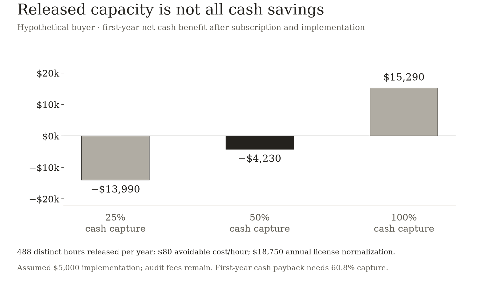
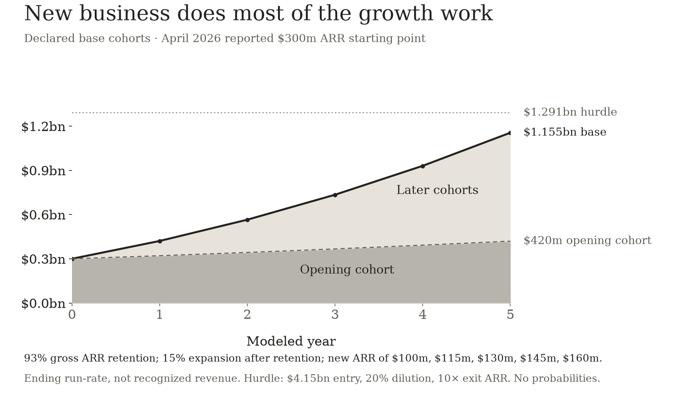

# Vanta: The Business After the Audit

The recurring job is keeping evidence useful. I model post-audit retention, new ARR and the investment return at the last disclosed financing benchmark.

I would put Vanta ahead of Harvey on a private-company diligence list because the recurring job is easier for me to identify. A company changes its systems, hires people, adds vendors, and answers questions from customers. Evidence that was sufficient for the last audit can become stale. If Vanta becomes the place that evidence is maintained and reused, the subscription can earn its place throughout the year.

The weak version of the business is a project: get a young company through an audit, then wait for renewal. The stronger version connects ongoing control work to the evidence buyers need before signing or renewing contracts. I would invest in the second version if the retention and acquisition economics support it.

The valuation still creates a hurdle. Using the last disclosed $4.15 billion financing benchmark, my illustrative base case produces a 17.4% annualized return over five years after 20% future dilution. A 20% hurdle requires either a lower entry around $3.71 billion on equivalent terms or better operating results. Vanta merits the next round of diligence; the headline valuation is not enough to finish it.

## The job keeps changing after the report is issued

A company can complete an audit and immediately begin changing the environment the audit described. A new application gets access to customer data. An employee moves to another role. A policy changes. Another buyer asks for proof using a different questionnaire. Keeping the record current is a separate job from assembling it once.

Vanta's product documentation makes that recurring work tangible. Automated tests retain evidence about what was checked and the data retrieved from connected services. Customers can share that evidence with an auditor, who performs the assessment. The software coordinates the work; it does not make the independent audit disappear. [Automated test evidence](https://help.vanta.com/en/articles/11345529-automated-test-evidence), [auditor workflow](https://help.vanta.com/en/articles/11345844-how-will-your-auditor-use-vanta).

The economic attraction is reuse. Evidence collected for one purpose can support another review if it is current, relevant, and approved for that use. A maintained answer can help the next questionnaire. A documented control can support several obligations. The customer pays once for a system that helps manage repeated work rather than starting a new evidence-gathering exercise each time.

The most valuable recurring process would connect a failed test to a responsible person, a correction, and a new piece of evidence. A dashboard that displays the failure is easier to replace than a process that reliably gets the correction completed. I would look for the latter in customer usage and renewal, because the display alone can become a feature in someone else's product.

## The disclosed numbers support a real business

Vanta announced a $150 million Series D at a $4.15 billion valuation in July 2025, when it reported serving more than 12,000 companies. In April 2026, it announced that ARR had crossed $300 million and thanked 16,000 customers. Those are company-reported checkpoints, not audited financial statements available in this analysis. [Series D announcement](https://www.vanta.com/resources/vanta-announces-series-d), [April ARR milestone](https://www.vanta.com/resources/vanta-crosses-300m-in-arr-as-growth-accelerates).

The growth is encouraging, but I would keep the dates attached. Dividing the July financing value by the following April's ARR gives roughly 13.8 times. That is a comparison across two dates. It is neither the multiple investors paid in the Series D nor an observable price at which I can purchase shares today.

For the model, I start with the disclosed $300 million run-rate and treat $4.15 billion as a hypothetical entry benchmark. I give no credit for unreported growth after the April checkpoint. The five-year clock begins at this modeled starting state; it does not reconstruct the return of investors who entered in July 2025.

The ratio of $300 million ARR to 16,000 customers is $18,750. I use it below to make an illustrative buyer budget concrete. It is not disclosed list pricing, verified average contract value for a paid cohort, or evidence that every customer pays that amount. The public measures do not provide the segmentation needed to make those claims.

## Time saved has to reach the buyer's budget

Suppose a customer pays that normalized $18,750 per year and spends another assumed $5,000 implementing the software in year one. I assume it saves eight hours a week across 46 weeks of control and evidence work. Separately, it answers ten questionnaires a month and reduces each from ninety to thirty minutes. The weekly estimate excludes questionnaire work, so the same hours are not counted twice.

That releases 488 hours a year. At an assumed $80 of avoidable labor cost per hour, the full amount is $39,040. But a salaried security employee's time does not automatically become cash. I therefore test how much of that capacity replaces spending the buyer would actually have incurred, such as a contractor or an additional hire.

**Does released time turn into avoided spending?**

| Assumed cash capture | Avoided cash / year | First-year net benefit | Recurring net benefit |
| --- | --- | --- | --- |
| 25.0% | $9,760 | −$13,990 | −$8,990 |
| 50.0% | $19,520 | −$4,230 | $770 |
| 100.0% | $39,040 | $15,290 | $20,290 |

Hypothetical customer, not Vanta ROI evidence. $18,750 ARR/customer normalization plus assumed $5,000 first-year implementation; 488 distinct hours/year at $80 avoidable cost/hour. Auditor fees remain and are excluded from both alternatives. Capacity value and incremental deal outcomes are not credited as cash savings.

Hypothetical buyer economics at a coarse $18,750 annual license normalization. Released capacity is credited as cash only to the assumed extent that it avoids spending. First-year implementation is $5,000; audit fees remain.

With half the released capacity converted into avoided cash spending, the first year is $4,230 short of payback. Recurring annual benefit is only $770 after the subscription. Full cash capture produces a much stronger result, while 25% capture fails to cover the subscription even after implementation is complete. First-year cash payback requires about 60.8% capture under these assumptions.

The customer might still buy at lower cash capture. More work can get completed with the existing team; control failures can be addressed sooner; buyers can receive better evidence. Those are plausible benefits that the narrow cash model omits. I would establish them separately rather than use theoretical salary savings to imply that payroll falls.

The number of working weeks is another claim to earn. If the eight-hour weekly saving lasts for only sixteen weeks around the audit, while questionnaires still arrive throughout the year, released time falls to 248 hours. At 50% cash capture, the first-year deficit widens to $13,830 and the recurring year loses $8,830. The original 46-week assumption therefore carries part of the recurring-business thesis itself.

**First-year cash benefit depends on a year-round job**

| Weeks of control/evidence savings | 25% cash capture | 50% cash capture | 100% cash capture |
| --- | --- | --- | --- |
| 16 | −$18,790 | −$13,830 | −$3,910 |
| 32 | −$16,230 | −$8,710 | $6,330 |
| 46 | −$13,990 | −$4,230 | $15,290 |

Hypothetical first-year benefit after the $18,750 license normalization and $5,000 implementation. Questionnaires continue throughout the year and are counted separately. All workload and cash-capture rates are assumptions.

I am equally careful with the sales argument. Finishing a questionnaire sooner can help a deal move. It does not make the whole contract incremental revenue. The relevant counterfactual is whether the company would otherwise lose the deal, win it later, or spend more to complete the review. A buyer that uses Vanta for every enterprise sale has a more credible recurring job than one that used it intensively for a single audit and then stopped.

## Separate retained growth from new sales

The company-level model begins with $300 million of ARR and tracks money cohorts. I retain a share of each cohort, expand the retained amount, and then add that year's new ARR. The added cohort gets no expansion until the following year. These are ending run-rates, not recognized revenue, cash receipts, or profits.

In the base, gross ARR retention is 93%. The retained amount expands by 15%, producing net ARR retention of 106.95%: 0.93 × 1.15. Starting with $100 of ARR, $7 is lost and $13.95 of expansion is added to the surviving $93. The old cohort ends at $106.95. Expansion is measured after losses, so the model does not apply it to the revenue that disappeared.

I then assume new ARR of $100 million, $115 million, $130 million, $145 million, and $160 million over the five years. These are authored acquisition requirements. Vanta has not disclosed the cohort retention, acquisition spending, or expansion rates needed to verify this case.

**Base ARR bridge by modeled year**

| Year | Opening ARR | Lost ARR | Expansion after retention | New ARR | Ending ARR |
| --- | --- | --- | --- | --- | --- |
| 1 | $300m | $21m | $42m | $100m | $421m |
| 2 | $421m | $29m | $59m | $115m | $565m |
| 3 | $565m | $40m | $79m | $130m | $734m |
| 4 | $734m | $51m | $102m | $145m | $930m |
| 5 | $930m | $65m | $130m | $160m | $1,155m |

USD millions; rounded only for display, so displayed rows may not sum exactly. $300m anchor disclosed April 29, 2026. Assumed gross retention 93%, expansion 15% of retained ARR, NRR 106.95%. New cohorts added at year-end. Ending ARR is not recognized revenue or cash receipts.

Declared five-year money-cohort scenario: 93% gross retention, 15% expansion after retention and annual new ARR of $100m to $160m. The opening $300m is a dated company disclosure; all subsequent values are modeled ending run-rates.

The base reaches about $1.155 billion ARR. The original $300 million cohort grows to roughly $420 million; the remainder comes from new cohorts and their later expansion. This makes the burden of the pitch visible. Moderately positive retention and expansion help, but they do not do most of the work. The company still has to add substantial new business year after year.

At the coarse $18,750 normalization, $100 million of new ARR is equivalent to about 5,333 customers, and $160 million to about 8,533. I am not forecasting those logo counts. Larger enterprise contracts can reduce the number of customers required, while smaller contracts increase it. The conversion tells me why customer mix, sales effort, and contract size deserve attention alongside the ARR total.

Moving upmarket can support larger contracts and more use cases. It can also bring longer sales cycles, implementation demands, and procurement work. I would need the incremental gross profit and acquisition payback of that motion. A larger average contract does not automatically make growth more efficient.

## The financing benchmark requires a much bigger outcome

For an equivalent pro-rata investment, a 20% annualized return over five years with 20% future dilution requires exit equity value of $4.15 billion × 1.20⁵ ÷ 0.80, or $12.91 billion. At ten times exit ARR, the company needs about $1.291 billion ARR. At six times, it needs $2.151 billion. At twelve times, it needs $1.076 billion.

**What the $4.15bn entry benchmark must become**

| Assumed exit equity / ARR | Required exit equity | Required exit ARR |
| --- | --- | --- |
| 6× | $12.908bn | $2.151bn |
| 10× | $12.908bn | $1.291bn |
| 12× | $12.908bn | $1.076bn |

20% annualized five-year hurdle, 20% future ownership dilution. July 2025 financing value is only a hypothetical entry benchmark paired with the April 2026 ARR starting state. No current share price, actual Series D return, security terms or probability claim.

The base cohort model is close to the ten-times hurdle, but it does not reach it. That is why I would use about $3.71 billion as the maximum equivalent entry for the 20% target under this case. It is a calculation from assumed operating results, not a claim about a current private share price.

## Renewal failures change the outcome

The downside case uses 85% gross retention, 5% expansion of retained ARR, and new ARR rising from $50 million to $70 million. Net retention falls below 90%. The company still wins new business, but much of it replaces what leaves. Ending ARR is about $417 million, and six times ARR produces a modeled investor loss of 13.6% a year after dilution.

The upside uses 95% gross retention, 22% retained-ARR expansion, and new ARR rising from $110 million to $210 million. At twelve times ending ARR, the modeled return is 31.1% a year. That case needs strong enterprise expansion and continued acquisition; it is not simply the base with a more generous valuation.

**Different retention and acquisition paths**

| Path | Gross retention | Retained expansion | Annual new ARR, years 1–5 | Exit ARR / multiple | Investor annual return |
| --- | --- | --- | --- | --- | --- |
| Downside | 85.0% | 5.0% | 50, 55, 60, 65, 70 ($m) | $0.417bn / 6× | -13.6% |
| Base | 93.0% | 15.0% | 100, 115, 130, 145, 160 ($m) | $1.155bn / 10× | 17.4% |
| Upside | 95.0% | 22.0% | 110, 135, 160, 185, 210 ($m) | $1.675bn / 12× | 31.1% |

Declared five-year scenarios from $300m reported ARR; no actual cohort rates inferred. 20% future dilution; no fees, distributions, net-cash addition or preference waterfall. Entry benchmark $4.15bn. Retention, growth and financing requirements should be connected in real diligence.

The exit multiples and dilution are assumptions. I do not have audited margin, cash-burn, balance-sheet, or security-rights information in this evidence set. The model assumes equity value is the stated multiple of ARR and does not add a separate net-cash adjustment. It also excludes fees, preference waterfalls, distributions, and any secondary-sale premium. Those details can materially change the return on an actual investment.

## The moat would have to survive competition and export

Vanta has a plausible compounding advantage if it becomes the maintained record of controls, evidence, vendors, and customer commitments. More repeated work can improve the product's usefulness: the next review begins with an existing record and known owners rather than a blank spreadsheet. The customer can become more reluctant to replace that operating process as it grows.

I would not call that a network effect simply because Vanta has many customers. Another customer joining does not necessarily make an existing customer's controls more useful. A stronger claim would need evidence that common workflows, integrations, or reusable assurance processes improve the service for participants in a way a competitor cannot cheaply reproduce.

The competition is already pointed at the same job. Drata offers questionnaires generated from approved trust content, review workflows, and reusable answers. Vanta cannot rely on owning the idea of automating a questionnaire. [Drata's assurance product](https://drata.com/products/assurance/security-questionnaire-automation).

Data portability also limits a simple lock-in argument. Vanta documents exports for controls, evidence, vendors, risks, and questionnaires, with specific limitations and no single export-everything function. Moving a live process can remain costly, but I would distinguish the cost of recreating a functioning workflow from the mere presence of stored documents. [Export documentation](https://help.vanta.com/en/articles/14998654-exporting-your-data-from-vanta).

The advantage I would pay for is a customer that stays because the next month's work is easier and better. If the reason for staying is chiefly migration friction or the timing of the next audit, a competitor can attack the renewal with assistance and a lower price.

## The strongest bear case is an annual project in subscription clothing

A young company can use Vanta heavily while preparing its first audit and much less afterward. If that pattern dominates, the product may have an urgent initial sale and a weak recurring claim. Retention can deteriorate as startup budgets tighten, companies close, or a larger customer consolidates tools.

The public growth milestone cannot distinguish that pattern from a deeply embedded recurring system. Rapid new sales can conceal weak retention for a time. Expansion by a few large customers can also conceal a weaker long tail. I would want cohorts separated by customer size, acquisition period, and original use case, including customers that began with an audit and later adopted ongoing assurance work.

Vanta's March 2026 product notes describe automatic renewals for customers with one to ten employees on selected plans. That is a reminder to pair renewal with active use and delivered value. A continuing contract can be a useful signal without proving that the customer has a recurring job for the product. [Product update record](https://help.vanta.com/en/articles/11345422-product-updates).

The current company's direction is consistent with the stronger thesis. Its April announcement describes continuously updated evidence and broader risk workflows. I treat that as product direction. The investment evidence would be post-audit use, renewal without large concessions, and expansion that earns attractive gross profit after implementation and support.

## Why Vanta gets the next diligence slot

Of these two private-company pitches, Vanta gives me a clearer bridge from recurring work to a recurring budget and a less demanding headline entry benchmark. Its disclosed ARR checkpoint also lets me start a cohort model with an identified quantity rather than normalize an unknown current revenue base.

I would advance it if audit-origin customers keep using the system between audits, if retention and expansion approach the base assumptions, and if new ARR is acquired without consuming an unreasonable share of future gross profit. I would also verify whether the subscription helps complete work the buyer values enough to fund, rather than rely on a wage-based time-savings calculation.

I would stop advancing the pitch if renewals mostly depend on discounts around audit dates, if usage falls after the report, or if enterprise expansion brings costs that erase the benefit of larger contracts. The company can remain useful while producing an unattractive investor outcome.

At equivalent entry economics below about $3.71 billion, the modeled base clears my 20% hurdle. At the disclosed $4.15 billion benchmark, I would need stronger evidence or stronger results. The business I would want to own is the work that continues after the audit: keeping evidence current, resolving exceptions, and helping the next buyer make a decision. The return depends on how reliably Vanta turns that work into retained, profitable revenue.

## Scope

$300m ARR and 16,000 customers are April 29, 2026 company disclosures; $4.15bn is the July 2025 financing benchmark. Their ratio is not the Series D entry multiple or a current share price. Future cohort rates, acquisition, costs and valuation multiples are assumed. The $18,750 customer normalization is not disclosed pricing. Security rights, audited margins and cash needs remain unverified.

## Sources

- [Series D announcement](https://www.vanta.com/resources/vanta-announces-series-d) — Vanta, 2025-07-23; verified 2026-10-12. $150m raise, $4.15bn announced valuation and more than 12,000 companies. This older benchmark is not a current transaction or a description of security rights.
- [April 2026 ARR milestone](https://www.vanta.com/resources/vanta-crosses-300m-in-arr-as-growth-accelerates) — Vanta, 2026-04-29; verified 2026-10-12. Company reports ARR crossed $300m and 16,000 customers. Model uses $300m as a dated anchor. $18,750 ARR/customer is a coarse normalization, not list price or verified paid-cohort ACV.
- [Automated test evidence](https://help.vanta.com/en/articles/11345529-automated-test-evidence) — Vanta Help Center, Current documentation; verified 2026-10-12. Documents data retrieval, test evidence and auditor view. No independent effectiveness or security-outcome claim is inferred.
- [Auditor workflow](https://help.vanta.com/en/articles/11345844-how-will-your-auditor-use-vanta) — Vanta Help Center, Current documentation; verified 2026-10-12. Independent auditor assessment, customer evidence and engagement workflow. Software is not assumed to replace the auditor or audit fee.
- [Data exports](https://help.vanta.com/en/articles/14998654-exporting-your-data-from-vanta) — Vanta Help Center, Current documentation; verified 2026-10-12. Section-level exports and specific limitations; no export-everything function. Does not establish either frictionless migration or inescapable lock-in.
- [Drata security-questionnaire automation](https://drata.com/products/assurance/security-questionnaire-automation) — Drata, Current product page; verified 2026-10-12. Approved content, review control and answer reuse are competing product capabilities, not a verified superiority or pricing comparison.
- [Vanta product update record](https://help.vanta.com/en/articles/11345422-product-updates) — Vanta Help Center, March 2026 entry; verified 2026-10-12. Automatic renewals for one-to-ten-headcount customers on selected plans. A renewed subscription alone is not taken as evidence of active post-audit use or poor customer value.
