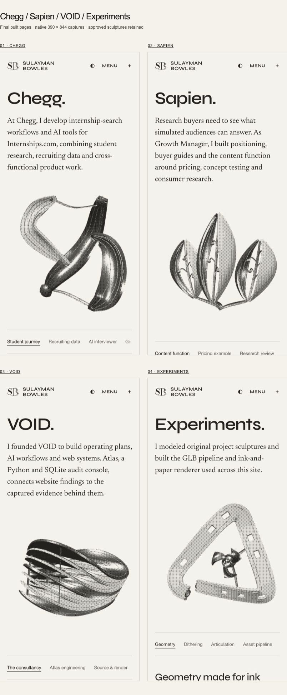
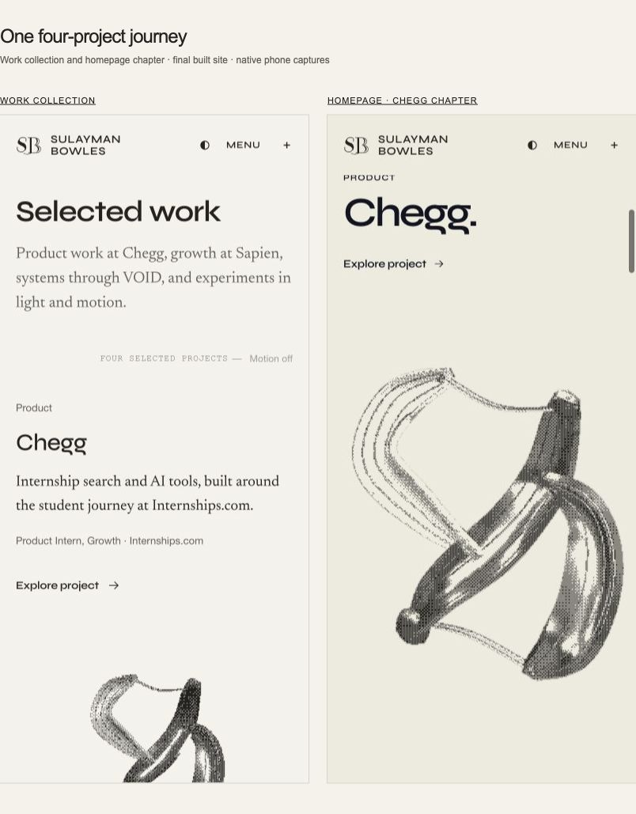

# Four featured projects · October 14, 2026

Chegg → Sapien → VOID → Experiments is now the primary Work journey. The actual Work collection, homepage chapters, readable HTML, structured data and continuation links share this order. Legacy project URLs remain readable.

| Featured account | Accepted sculpture | Work covered |
| --- | --- | --- |
| Chegg | Equilibrium · current Markets GLB | Internships.com student research, recruiting data, AI mock interviewer and growth research. |
| Sapien | Counterfactual choir | Existing growth, buyer guides and research account. |
| VOID | Palimpsest · current Atlas GLB | Consultancy scope, with Atlas’s engineering, pinned sources and retained evidence comparison. |
| Experiments | Unfinished Continuum | Existing procedural geometry, engraving, articulation and asset pipeline account. |

All sixteen registered GLBs and the engraving shader match revision 8 exactly. VOID’s presentation angle opens the layered form; no accepted asset was regenerated. The Chegg and VOID roles and contributions come from the site’s reviewed public résumé. Atlas’s July 16 source sample retains its date, unknown values and source-versus-render distinction.

These are native screenshots of the final built site. Each phone image is displayed at its original 390 × 844 pixels in the browser overview. Desktop openings and complete new accounts were also inspected at 1235 × 984. All four project openings and both Work/home surfaces have no document overflow. The native four-project continuation, chapter jumps, Chegg/VOID keyboard rotation/reset and VOID pointer/double-click reset pass. The Experiments rotor advances for a 61-second observation near the renderer’s 30 fps cadence. GPU timing and physical-device touch were not measured.

Validation: 702 application tests; application TypeScript; client and SSR builds; 49 readable canonical pages; release/search gate with 82 retained redirects and 1,626 asset references; sixteen-asset source/built/baseline byte audit; diff whitespace check. API and bot code are unchanged by this curation revision. Prior sculpture generation and validation are documented in ../project-sculptures-preview-20261014/README.md.

Delivery targets the existing [PR #100](https://github.com/SulaymanB2024/Portfolio_Site/pull/100). This is a branch preview, not a production publication. Local built routes while the task’s bounded preview is active: [Work](http://127.0.0.1:4217/work), [Chegg](http://127.0.0.1:4217/work/chegg), [Sapien](http://127.0.0.1:4217/work/sapien), [VOID](http://127.0.0.1:4217/work/void), [Experiments](http://127.0.0.1:4217/work/miscellaneous).
