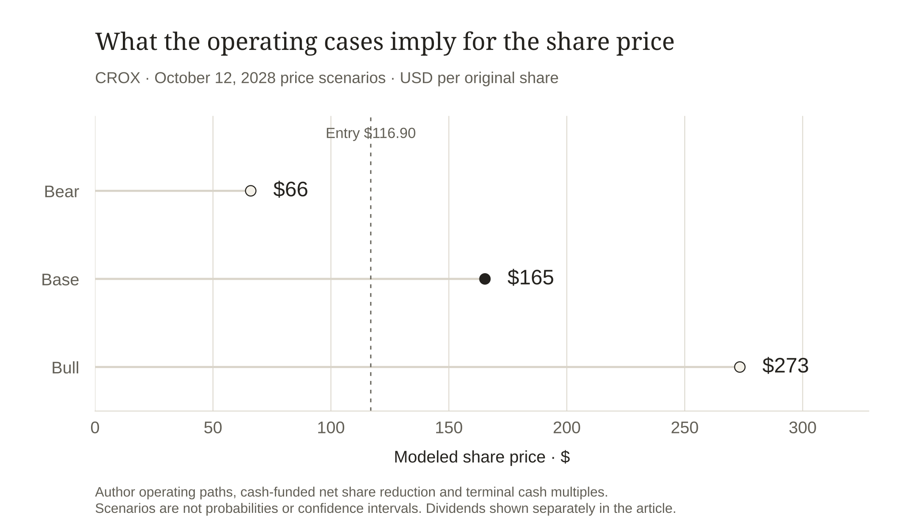

# Crocs: A Cash Engine with a Brand Test

Written October 13, 2026; information/entry cutoff October 12, 2026.

I am positive on Crocs at the October 12, 2026 close of **$116.90**. My central price forecast is **$165 for October 12, 2028**. The case rests on a profitable footwear franchise, a modest growth requirement and cash that can reduce the number of outstanding shares. I do not need HEYDUDE to return to its acquisition-era promise for this long to work.

The price leaves room for an ordinary business result. At the midpoint of the latest 2026 guidance, Crocs trades at about 9.3 times GAAP earnings and 8.4 times adjusted earnings. Both measures deserve attention: the adjusted figure uses a lower tax rate, while the business also carries a substantial uncertain-tax balance. I prefer to value recurring cash after charging for compensation and protecting part of the cash budget. [C3](#source-c3)

## The profitable brand is larger than the failed acquisition story

The business contains two very different assets. Crocs sells a recognizable product through wholesale partners and its own stores and digital channels. HEYDUDE contributes a smaller revenue base and has disappointed badly enough to require major asset impairments. The relevant investment question is how much the core brand can earn while the second brand remains weak.

The trailing year through June 2026 generated $4.055 billion in revenue. Crocs brand contributed $3.372 billion; HEYDUDE contributed $682 million. I obtain those figures from the full 2025 year plus the current first half less the comparable prior first half. This keeps the summer quarter from becoming a false annual run rate. [C1](#source-c1) [C2](#source-c2)

Within Crocs brand, the trailing North American and international businesses were almost equal: $1.689 billion and $1.684 billion. That matters because the stock's next chapter does not depend entirely on another surge in US popularity. The international share was 48.6% in 2025, up from 41.0% in 2023. A familiar product can grow through distribution and local adoption even when its oldest market matures. Those reported sales establish the geographic shift; they do not establish customer retention or future demand. [C1](#source-c1)

The latest quarter gives the positive case a concrete direction. Crocs international revenue rose 7.8%, North America rose 0.4%, and the brand's direct-to-consumer revenue rose 12.9%. HEYDUDE revenue fell 5.7%, although its direct channel grew. I would rather underwrite expansion of the profitable brand than assign a large rescue value to the smaller one. [C3](#source-c3)

**Reconstructed trailing revenue by business**

| Business | Revenue · $m |

| --- | --- |

| CROCS BRAND | 3,372.461 |

| HEYDUDE | 682.405 |

FY2025 + H1 2026 − H1 2025; overlapping geographic/channel cuts are not added to business totals. [C1](#source-c1) [C2](#source-c2)

## Growth has to survive the cost of reaching the customer

Direct selling can capture more of the retail price and improve the customer relationship. It also requires stores, fulfilment, advertising and inventory. Crocs had 484 brand stores in June 2026 versus 412 a year earlier. A rising direct-sales share therefore cannot be translated automatically into a rising profit margin. [C2](#source-c2)

The revenue bridge is revealing. In the second quarter, price and mix added about $37.9 million, lower net volume removed $14.1 million, and currency added $6.3 million. Across the first half, the volume effect was negative $86.2 million. Selling more dollars of footwear is useful, but the quality of that growth depends on how much comes from units, price and channel mix. [C2](#source-c2)

I see the international/direct expansion as the opportunity and margin preservation as its test. The product has room to reach more customers. The expansion earns a higher valuation only if those customers leave enough contribution after the cost of serving them. A growing store network with worsening sell-through would change my view quickly.

The earnings comparison is less flattering than the headline EPS growth. Second-quarter adjusted net income fell from $237.5 million to $225.7 million, while adjusted diluted shares fell from 56.1 million to 49.6 million. Adjusted EPS consequently rose from $4.23 to $4.55. The benefit to each remaining share is real. It is also evidence that the operating business still needs to improve. Crocs keeps stock compensation inside adjusted earnings, unlike some software companies. [C3](#source-c3)

 [C3](#source-c3)](../figures/crocs-profit-and-shares.svg)

Q2 adjusted earnings per share rose while adjusted net income fell. SBC remains inside Crocs' adjusted earnings; diluted share reduction explains the difference. [C2](#source-c2) [C3](#source-c3)

## The cash exists, but its recent increase is not all operating progress

The trailing cash statement produces a useful starting point: $762.6 million of operating cash less $58.0 million of cash capex gives $704.6 million of free cash flow. Charging the $41.5 million of stock compensation added back to CFO leaves a $663.1 million economic cash proxy. Compensation is a cost even when the company issues shares rather than paying cash. This deduction approximates that cost; it does not measure the exact dollars needed to neutralize dilution. [C1](#source-c1) [C2](#source-c2)

On the latest disclosed July 23 count of 47.945 million shares, the entry price implies approximately $5.605 billion of equity value. The proxy represents an 11.8% cash yield on that approximate capitalization. That is the attraction: the existing business can produce a substantial amount relative to the price of its common equity. The share count and the quote have different dates, so I do not describe the capitalization as an exact October observation.

I underwrite **$600 million** of recurring annual cash, below that reported proxy. The first-half CFO improvement was $52.2 million, but the favorable change in the income-tax working-capital line was $81.1 million. Tax timing helped the cash statement more than the total improvement. A lower, rounded cash anchor is more useful than assuming the latest conversion repeats indefinitely. It is my assumption, not an extra reported expense or a company target. [C2](#source-c2)

The tariff refund also needs the right date. Crocs disclosed approximately $20 million received after June 30, with the benefit expected in third-quarter cost of sales. It is absent from the June cash anchor, and the earnings outlook explicitly excludes potential refunds. I neither add it to recurring earning power nor subtract it again from guidance that already excludes it. [C2](#source-c2) [C3](#source-c3)

**Trailing cash bridge · USD millions · ending 2026-06-30**

| Measure | Amount · $m |

| --- | --- |

| Operating cash flow | 762.634 |

| Cash capital expenditure | −58.014 |

| Reported free cash flow | 704.620 |

| CFO-added stock compensation | −41.517 |

| Author rounded recurring-cash underwriting | -63.103 |

| Cash underwriting anchor | 600.000 |

FY2025 + current comparable interim − prior interim. Compensation/normalizations are author sensitivities, not additional reported cash expenses. [C1](#source-c1) [C2](#source-c2)

 [C2](#source-c2)](../figures/crocs-cash-underwriting.svg)

Reported operating cash becomes a lower underwriting anchor after cash capex, compensation and labeled company-specific sensitivities. Matching trailing periods; USD billions. [C1](#source-c1) [C2](#source-c2)

## A smaller share count has to fit inside the cash budget

The board increased repurchase permission to approximately $2 billion. Permission does not fund a purchase. The balance sheet also showed $1.334 billion of debt principal, operating leases and a sizeable tax uncertainty. Those claims compete with capital returned to common shareholders. [C2](#source-c2) [C3](#source-c3)

Past reductions in outstanding shares are substantial: the rounded June share counts fell about 12% over a year. Yet first-half repurchase cash exceeded the cash proxy after compensation, and face borrowings increased by $72 million. I want future per-share growth to be earned through cash generation rather than projected by repeating a debt-supported purchase rate. Treasury purchases reduce outstanding shares; they do not necessarily cancel those shares permanently. [C2](#source-c2)

My base budget protects $150 million annually for debt reduction and $100 million for tax or liquidity needs. It then attempts 7% net share reduction annually, using assumed average purchase prices of $145 and $165. The model caps purchases at the cash actually left. Both caps bind, leaving a smaller reduction than the requested rate. The economic compensation reserve is already charged before funding net reduction, so gross buyback spending is not added as another investment return.

This restraint is part of the long thesis. Low valuation can make repurchases productive, but management also has to preserve the franchise and the balance sheet. Spending every available dollar on shares while an important cash claim remains unresolved would weaken the quality of the investment case.

**Base-case cash allocation and affordable net share reduction**

| Author model | Year 1 | Year 2 |

| --- | --- | --- |

| Revenue · $m | 4,176.12 | 4,303.04 |

| Cash after compensation/reinvestment · $m | 626.42 | 645.46 |

| Additional protected cash/debt budget · $m | 250.00 | 250.00 |

| Dividend cash budget · $m | 0.00 | 0.00 |

| Net share-purchase funding · $m | 376.42 | 395.46 |

| Compensation-replacement proxy · $m | 50.11 | 51.64 |

| Cash left after allocations · $m | 0.00 | 0.00 |

| Ending shares · millions | 45.35 | 42.95 |

Forward cash margins already charge economic compensation and company-specific reinvestment. Net purchases do not receive a second return credit. Author $150m annual debt-paydown plus $100m annual protected tax/liquidity budget in the base case. Protected cash is unavailable for repurchases and receives no terminal valuation bonus. Gross repurchase permission is not funding. Net share retirement is capped by cash available; the two base-year caps bind. June cash is a historical reference, not October cash. $20m post-June refund is absent from the anchor and not added to recurring projections.

## The tax balance is the strongest reason to keep a reserve

June long-term income taxes payable were $639.6 million. The annual filing reported $637.0 million of unrecognized tax benefits, largely associated with intellectual-property tax positions, with settlement amount and timing uncertain. These are related tax-risk disclosures, not two obligations to be added together. Deferred tax assets are not cash available to fund the bill. [C1](#source-c1) [C2](#source-c2)

I stress a hypothetical $600 million first-year payment. It replaces the $100 million already protected in the base budget, requiring another $500 million of allocation. Repurchases stop in that year, and the model shows an approximately $123.6 million gap against cash after the compensation charge. June's $170.3 million unrestricted cash is only a historical reference; using it mechanically would leave roughly $46.7 million. That is a material loss of flexibility.

The stress's cash-only price calculation is about $156, below the base value. That number should not make the event look harmless: it omits the cost of any new funding, dilution or operating disruption needed to restore liquidity. The important signal is that a large early tax payment could force a different capital plan. I would suspend the assumed purchase schedule as soon as actual commitments require the cash.

My positive view therefore depends on disciplined allocation as well as the footwear brand. A cheap equity can remain cheap if capital repeatedly goes to uncertain claims or expensive repurchases. The next filings should improve the picture of cash available after those claims.

## The forecast asks for modest growth and a modest revaluation

The base operating case grows Crocs brand revenue 4% annually, lets HEYDUDE decline 2%, and converts 15% of total sales into recurring cash after compensation. That yields about $4.303 billion of revenue and $645 million of cash in the second model year. The brand assumption is slightly stronger than the current full-year guide; it requires the international/direct opportunity to continue. HEYDUDE is not assumed to recover.

An 11-times multiple of that cash per ending share gives **$165.30**; I round the prospective price forecast to **$165**. The multiple corresponds to about 11.8 times earnings under a separate 14% net-margin check. It rewards a business that preserves recurring profitability and allocates capital well without requiring an exceptional consumer growth story. It remains an author valuation judgment.

Keeping today's multiple on the lower $600 million cash anchor gives a second-year price near $140. That is useful upside, but it falls just short of a 10% annual price-return hurdle. The $165 forecast therefore includes some revaluation. I make that dependency explicit instead of presenting the entire gain as an inevitable consequence of buybacks.

The reverse test recalculates affordable share reduction as cash changes. Under the base growth, purchase-price and valuation assumptions, second-year cash of roughly $565 million supports the chosen 10% annual price hurdle. That is below the $600 million underwriting anchor. It is a conditional diagnostic: weaker growth, a lower multiple or a cash settlement would change the result together.

**The cash hurdle for a 10% annual price return**

| Conditional author diagnostic | Value |

| --- | --- |

| Required horizon share price | $141.45 |

| Year 2 recurring cash required | $565.4m |

| Cash change vs current underwriting anchor | -5.8% |

| Recalculated ending shares | 43.973m |

Scale both annual owner-cash margins; retain base revenue growth, repurchase prices, commitments, dividends and terminal multiple. Recalculate affordable net share reduction. This is an author diagnostic, not a market forecast. The 10% hurdle is a choice, not a forecast for SPY.

Bear, base and bull operating paths use affordable share reduction and explicit terminal cash multiples. Prices are author scenarios for October 12, 2028, without probabilities; dividends are separate.

## What I expect to observe before the price target

My operating forecast for the trailing period available before October 2028 is Crocs brand revenue above $3.6 billion, recurring cash after compensation around $645 million, and fewer than 44 million outstanding shares if the tax/liquidity budget remains sufficient. I also expect the company to maintain a consolidated adjusted operating margin above 21%. These are my tests of the business behind the price, separate from management guidance.

The quarterly catalysts are practical: international demand sustaining growth, North America holding its base, investment producing usable direct-channel economics, and filings showing actual net share reduction. Better disclosure of tax cash needs would make the capital-allocation forecast more reliable. A refund or the disappearance of an old impairment charge would not, by itself, satisfy those tests.

I would reconsider the long if Crocs brand North America and international sales both contract for two comparable quarters, if adjusted operating margin stays below 20%, or if recurring cash falls below $500 million while debt-funded repurchases continue. I would also revise the share forecast immediately when a material tax payment is scheduled. Those conditions distinguish an ordinary delay from a damaged investment thesis.

**Dated operating predictions and conditions that change the long**

| Observation | Author test |

| --- | --- |

| By latest available 2028 trailing period | Crocs brand revenue above $3.6bn; recurring cash around $645m; fewer than44m outstanding shares |

| Operating margin | Consolidated adjusted operating margin above 21%; evidence that direct expansion retains profit |

| Reconsider | Both Crocs geographies contract twice, margin below 20%, cash below $500m with debt-funded purchases, or a material tax payment crowds out repurchases |

Use full comparable periods and the same cash definitions. These thresholds are author forecasts, not company guidance. Preserve the original price forecast when revising the thesis.

## A long on the earning franchise

My positive case is that the core Crocs franchise can keep producing cash while international distribution expands and the share count declines at an affordable pace. The entry price allows that result to matter. HEYDUDE weakness, tax uncertainty and the recent profit decline are already part of my underwriting rather than reasons to assume a flawless recovery.

I prefer the $165 two-year forecast because it connects the consumer business to a concrete capital budget. The outcome will be judged against the original $116.90 close and SPY on the same future date. A good story will not excuse weak realized results, and a later revision will not replace this dated forecast.

## Evidence boundary

Public-source equity pitch written October 13, 2026, with information/entry-price cutoff October 12. Latest financial period: 2026-06-30. Latest disclosed shares: 2026-07-23; exact October shares/cash are not asserted. Author cash sensitivities, operating paths, purchase prices, valuation multiples and disconfirmation thresholds are labeled. Future accuracy is unobserved; no holdings or company work are implied.

## Sources

**C1 · [Crocs FY2025 Form 10-K](https://www.sec.gov/Archives/edgar/data/1334036/000133403626000006/crox-20251231.htm)** · 2026-02-12

Annual/earlier cash and revenue, geographic mix, impairment and uncertain tax positions.

Reported facts, management guidance and author projections have different status; current share/cash dates remain explicit.

**C2 · [Crocs Q2 2026 Form 10-Q](https://www.sec.gov/Archives/edgar/data/1334036/000133403626000052/crox-20260630.htm)** · 2026-07-30

H1 cash, segments, price/volume bridge, share count, tax payable and subsequent tariff refund.

Reported facts, management guidance and author projections have different status; current share/cash dates remain explicit.

**C3 · [Crocs Q2 2026 earnings release](https://www.sec.gov/Archives/edgar/data/1334036/000133403626000050/croxq22026-pressrelease.htm)** · 2026-07-30

Adjusted profit and share bridge; GAAP/adjusted guidance excludes potential tariff refunds.

Reported facts, management guidance and author projections have different status; current share/cash dates remain explicit.

**C0 · [Alpaca SIP daily close · October 12, 2026](https://docs.alpaca.markets/reference/stockbars)** · 2026-10-12

Actual SIP daily bars and request parameters are frozen in the downloadable model bundle. This documentation link explains the bar schema; it is not a public display of the quoted close.

Daily close is the entry convention; no historical total-return adjustment is inferred. Corporate actions and distributions must be reconciled for evaluation.
