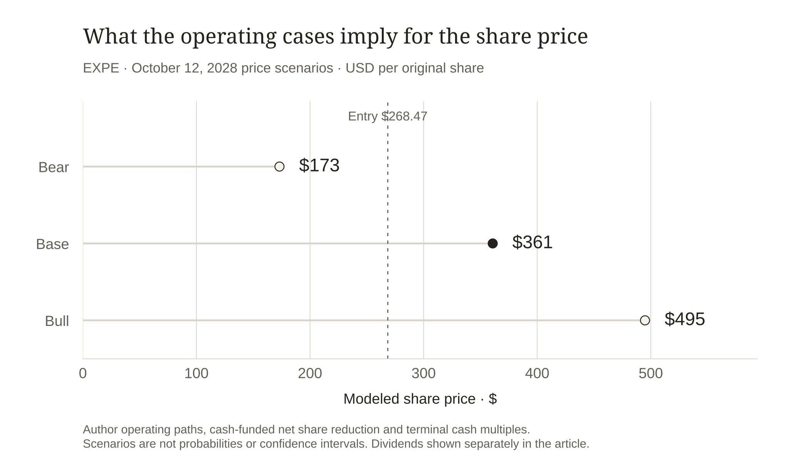

# Expedia: The Network Beyond the Booking

Written October 13, 2026; information/entry cutoff October 12, 2026.

I am positive on Expedia at the October 12, 2026 close of **$268.47**, with a central price forecast of **$360 for October 12, 2028**. The opportunity is a consumer travel marketplace becoming more efficient while its partner business grows on the same supply network. I expect both sides to contribute, with different economics.

The attractive number is not the spring cash balance. Expedia collects money before much of the travel takes place, and that money still has a job to do. After removing a conservative travel-working-capital sensitivity and charging for stock compensation, I get about **$2.65 billion** of annual cash to underwrite. The long has to work from that lower figure.

## A travel network with two ways to reach the customer

Expedia's consumer brands bring travelers directly to hotels, vacation rentals and other services. The B2B business lets airlines, banks, travel agents and other partners offer travel using Expedia's supply and technology. Both can benefit from a larger network of inventory; they pay differently for demand.

The trailing year through June 2026 generated $15.700 billion of revenue. B2C contributed $9.834 billion and B2B $5.362 billion, with the remaining $504 million in other revenue. Those figures use the full 2025 year plus current first-half results less the comparable earlier first half. They preserve seasonality instead of doubling a strong interim result. [E1](#source-e1) [E2](#source-e2)

The partner channel offers an attractive way to grow. A company that already has travelers or cardholders can embed Expedia's inventory into its own experience. Expedia can earn from that relationship without making every traveler start on an Expedia-branded page. My inference is that wider distribution makes the network more useful and gives the company more routes to demand. The financial evidence then has to establish how much of the benefit it keeps.

I would not base the long on a prediction that AI removes every competing travel interface. Travelers can discover a trip through many interfaces, and partners can negotiate a large share of the economics. The investable asset is the combination of supply, service, technology and conversion that remains valuable to those interfaces. That is a business proposition to test, rather than a reason to assign an unlimited platform multiple.

**Reconstructed trailing revenue by business**

| Business | Revenue · $m |

| --- | --- |

| B2C | 9,834.000 |

| B2B | 5,362.000 |

| OTHER | 504.000 |

FY2025 + H1 2026 − H1 2025; overlapping geographic/channel cuts are not added to business totals. [E1](#source-e1) [E2](#source-e2)

## The fastest-growing business is not producing the fastest profit growth

The latest quarter contains the most useful tension in this pitch. B2B revenue grew about 23.5%, but adjusted segment EBITDA grew only 11.5%. Its margin fell from 27.4% to 24.7%. Partner commissions and growth investment absorb part of the expansion. Applying the consumer business's margin to those new partner dollars would overstate the long. [E3](#source-e3)

B2C shows the stronger current profit conversion. Revenue grew about 8.0%, while adjusted segment EBITDA grew 22.1%, lifting margin from 29.4% to 33.2%. In the release's operating tables, B2C direct marketing rose only about 1% while its bookings grew about 8%. The consumer business retained more of the incremental revenue. That is a promising operating signal, although it does not guarantee the same acquisition efficiency every quarter. [E3](#source-e3)

This distinction changes the thesis. Expedia is not simply a fast-growing B2B business with a mature consumer operation attached. The current combination is a consumer operation improving its economics and a partner operation broadening distribution. I want the first to finance profitable expansion of the second.

The appropriate test for B2B is therefore revenue together with margin. More bookings can strengthen relationships and increase scale, but an expanding commission bill can leave less value for Expedia. A quarter of high growth with a lower margin can be a sensible investment period. Persistent margin deterioration would mean the company is passing too much of the benefit to its partners.

 [E3](#source-e3)](../figures/expedia-segment-conversion.svg)

Q2 B2C converted revenue growth into faster EBITDA growth; B2B's faster sales growth came with a lower segment margin. [E2](#source-e2) [E3](#source-e3)

## Booking growth has to become stayed revenue and usable cash

In the second quarter, booked room nights rose 6%, gross bookings rose 12%, and revenue rose 14%. Those measures have different timing and content. Bookings reflect transactions when booked and are adjusted for cancellations; much lodging revenue reflects completed stays. Pricing, mix and the timing of travel affect the relationship. [E3](#source-e3)

I am encouraged by the reported revenue growth, but I do not treat a dollar of gross bookings as a dollar of revenue or cash profit. The network must serve the trip, pay suppliers, handle refunds and cover the cost of acquiring demand. Growth in customer money arriving early is valuable financing only while those obligations remain funded.

The latest full-year guide raised revenue to $16.05–16.22 billion and expected 150–175 basis points of adjusted EBITDA-margin expansion. That is management's August outlook, rather than a reported full-year result. It supports an improving operating direction. My two-year case slows that growth rather than extending the strongest quarter unchanged. [E3](#source-e3)

The GAAP EPS headline also needs care. Second-quarter EPS of $7.16 includes investment and tax effects, while the first half benefited from a $71 million reversal of earlier Canadian digital-services-tax liabilities. I do not annualize the quarter or treat that reversal as recurring operating leverage. Nor do I charge the same potentially noncash reversal against CFO again without a cash reconciliation. [E2](#source-e2)

## Remove the deposit financing before deciding what to pay

The trailing cash statement shows $5.216 billion of operating cash and $757 million of cash capex, leaving $4.459 billion of reported free cash flow. A large part of the difference between that number and recurring cash earning power comes from travel working capital. [E1](#source-e1) [E2](#source-e2)

My sensitivity removes the net of three cash movements: $1.958 billion added by deferred merchant bookings, $319 million added by merchant payables, and $878 million used by receivables. Together they supplied $1.399 billion. Subtracting only the deferred-booking increase while ignoring receivables would penalize one side of the travel cycle. Keeping all of it as permanent shareholder cash would make the opposite mistake.

After removing that net source and the $412 million of compensation added back to CFO, the cash anchor is $2.648 billion. This is my conservative no-growth working-capital sensitivity. Total accounts receivable is an imperfect proxy because the filing does not separate every merchant and agency cash movement. The calculation is inspectable, and its limit matters: it is not an exact company-normalized maintenance-cash measure.

A second compensation sensitivity uses $502 million credited to equity instead of the CFO add-back, reducing the anchor to $2.558 billion. The filing's capitalized-compensation and parent-equity bases do not reconcile completely across the selected interim periods. I keep that alternative visible rather than claim that one proxy precisely measures every future dilution cost.

The balance sheet does not provide a separate cash windfall for the valuation. June cash and short-term investments totalled $7.127 billion, against $15.426 billion of deferred merchant bookings and continuing supplier obligations. I add no excess-cash bonus to the target. The operating cash flow already includes interest, and the equity valuation uses the cash that remains after that cost. [E2](#source-e2)

**Trailing cash bridge · USD millions · ending 2026-06-30**

| Measure | Amount · $m |

| --- | --- |

| Operating cash flow | 5,216.000 |

| Cash capital expenditure | −757.000 |

| Reported free cash flow | 4,459.000 |

| CFO-added stock compensation | −412.000 |

| Author no-growth travel-WC sensitivity | -1,399.000 |

| Cash underwriting anchor | 2,648.000 |

| Alternative equity-credit SBC sensitivity | 2,558.000 |

FY2025 + current comparable interim − prior interim. Compensation/normalizations are author sensitivities, not additional reported cash expenses. [E1](#source-e1) [E2](#source-e2)

 [E2](#source-e2)](../figures/expedia-cash-underwriting.svg)

Reported operating cash becomes a lower underwriting anchor after cash capex, compensation and labeled company-specific sensitivities. Matching trailing periods; USD billions. [E1](#source-e1) [E2](#source-e2)

## The base forecast lets each channel grow at its own rate

I grow B2C revenue 5% annually, B2B 15%, and other revenue at zero. That produces approximately $18.437 billion in the second model year. The partner assumption is slower than the latest quarter's revenue growth, and the consumer assumption does not require an exceptional travel boom.

I then assume 17% of consolidated revenue becomes recurring cash after an economic compensation charge and without incremental net travel-working-capital financing. That gives $3.134 billion, up from the $2.648 billion anchor. It requires the consumer margin improvement to persist and partner growth to retain enough contribution. I am not applying the B2C EBITDA margin to B2B sales.

The share count falls 3% annually from the latest disclosed July 24 count of 120.019 million, reaching 112.926 million. Before those purchases, the budget covers dividends and protects another $250 million annually for liquidity or debt needs. Assumed average purchase prices are $290 and $325. The model can fund the desired reduction from the remaining cash; gross compensation-neutralizing purchases do not become an extra return on top of the lower share count.

These are deliberate author assumptions. I prefer them to extrapolating the $1.9 billion of trailing repurchase cash as a buyback yield and then also claiming the benefit in EPS. Buybacks help when the remaining shareholders receive a larger claim on a sound cash business. They can weaken the investment when demand falls and customer obligations require the money.

**Base-case cash allocation and affordable net share reduction**

| Author model | Year 1 | Year 2 |

| --- | --- | --- |

| Revenue · $m | 16,996.00 | 18,437.23 |

| Cash after compensation/reinvestment · $m | 2,889.32 | 3,134.33 |

| Additional protected cash/debt budget · $m | 250.00 | 250.00 |

| Dividend cash budget · $m | 230.44 | 223.52 |

| Net share-purchase funding · $m | 1,044.17 | 1,135.08 |

| Compensation-replacement proxy · $m | 543.87 | 589.99 |

| Cash left after allocations · $m | 1,364.71 | 1,525.72 |

| Ending shares · millions | 116.42 | 112.93 |

Forward cash margins already charge economic compensation and company-specific reinvestment. Net purchases do not receive a second return credit. Forward cash margins exclude incremental net travel-WC financing and include economic stock compensation. Author $250m annual additional liquidity/debt budget. No excess-cash bonus. Dividend held at $0.48 quarterly as an assumption.

## A $360 forecast with visible valuation dependence

Thirteen times second-year cash per share gives **$360.82**; I round the prospective price forecast to **$360**. The exact model implies about 34.4% price appreciation from the entry. A constant $0.48 quarterly dividend would add $3.84 over eight quarters, but future declarations are assumptions and the primary benchmark compares price returns.

At the entry's multiple of the lower cash anchor, the same operating and share-count path gives about $338. The business case therefore supplies most of the modeled appreciation; some revaluation is still needed for the central target. A separate 11.5% net-margin assumption gives about $18.78 of second-year earnings per share, placing the target near 19.2 times that check. I use it to challenge the cash valuation, not add another valuation on top.

The reverse test asks what cash would support a 10% annual price return under the same channel growth, purchase-price and multiple assumptions. It recalculates the share count as cash changes. Roughly $2.822 billion in second-year cash is required, 6.6% above the current lower anchor. The hurdle is achievable, but it still asks the business to improve. Expedia is less forgiving than a case that works through stagnation.

**The cash hurdle for a 10% annual price return**

| Conditional author diagnostic | Value |

| --- | --- |

| Required horizon share price | $324.85 |

| Year 2 recurring cash required | $2,821.8m |

| Cash change vs current underwriting anchor | 6.6% |

| Recalculated ending shares | 112.926m |

Scale both annual owner-cash margins; retain base revenue growth, repurchase prices, commitments, dividends and terminal multiple. Recalculate affordable net share reduction. This is an author diagnostic, not a market forecast. The 10% hurdle is a choice, not a forecast for SPY.

Bear, base and bull operating paths use affordable share reduction and explicit terminal cash multiples. Prices are author scenarios for October 12, 2028, without probabilities; dividends are separate.

## The competing cases are about demand and who keeps the margin

The bear case combines consumer revenue declining 3% annually, partner revenue growing only 8%, a 13% cash margin and no net share reduction. At ten times cash, the value is around $173. A travel downturn can turn operating leverage against the shareholder quickly, even when the partner channel continues growing.

The bull case has 8% consumer growth, 20% partner growth, an 18.5% cash margin and an affordable 4% annual share reduction. Fifteen times cash gives about $495. That result needs better economics as well as volume. It is a favorable operating scenario, not a probability-weighted expected price or a confidence bound.

The strongest contrary case is that Expedia's distribution becomes larger while the margin it keeps shrinks. More partner demand, more marketing spending and more advance cash could all look like progress while durable shareholder cash disappoints. My model charges for that distinction, but the future outcome still depends on how the network competes and allocates capital.

## The observations that would earn the target

Before the October 2028 price evaluation, I expect the latest available trailing B2B revenue to exceed $7.0 billion, B2B adjusted EBITDA margin to be at least 25%, and B2C margin to remain at least 31%. I also expect the conservative cash sensitivity to exceed $3.0 billion and the share count to be below 114 million. Those operating predictions are explicit author tests, separate from management guidance.

The catalysts are quarterly evidence of B2B margin stabilization and continued B2C demand-acquisition efficiency, followed by a full travel cycle confirming cash conversion. Reported repurchases matter only insofar as they reduce actual outstanding shares without compromising travel obligations.

I would reconsider the long if B2B margin remains below 23% for two comparable quarters, if B2C margin drops below 28% without a clear temporary cause, or if the cash sensitivity falls below $2.2 billion over a full trailing year. Rising gross bookings would not override those results. A large payment, acquisition or new capital requirement would also change the budget before I repeat its share forecast.

**Dated operating predictions and conditions that change the long**

| Observation | Author test |

| --- | --- |

| By Q2 2028 | Trailing B2B revenue above $7bn; B2B adjusted EBITDA margin at least 25%; B2C margin at least 31% |

| Shareholder cash | Conservative travel-WC/compensation cash sensitivity above $3bn and shares below 114m |

| Reconsider | B2B margin below 23% twice, B2C margin below 28%, or annual cash sensitivity below $2.2bn |

Use full comparable periods and the same cash definitions. These thresholds are author forecasts, not company guidance. Preserve the original price forecast when revising the thesis.

## A positive case on retained economics

I believe Expedia can build a more valuable business by combining a better consumer operation with broader partner distribution. The current evidence supports that direction, and the entry price leaves room for the resulting cash to compound per share. My $360 forecast is a claim about those retained economics, not about the largest booking statistic.

The dated forecast remains available for comparison with the original entry and SPY. If the network expands but shareholders receive less cash than I expect, the prediction has failed on its own terms. That is the discipline I want the pitch to carry into the next two years.

## Evidence boundary

Public-source equity pitch written October 13, 2026, with information/entry-price cutoff October 12. Latest financial period: 2026-06-30. Latest disclosed shares: 2026-07-24; exact October shares/cash are not asserted. Author cash sensitivities, operating paths, purchase prices, valuation multiples and disconfirmation thresholds are labeled. Future accuracy is unobserved; no holdings or company work are implied.

## Sources

**E1 · [Expedia FY2025 Form 10-K](https://www.sec.gov/Archives/edgar/data/1324424/000132442426000008/expe-20251231.htm)** · 2026-02-12

Annual cash, travel working capital, compensation and segment results.

Reported facts, management guidance and author projections have different status; current share/cash dates remain explicit.

**E2 · [Expedia Q2 2026 Form 10-Q](https://www.sec.gov/Archives/edgar/data/1324424/000132442426000053/expe-20260630.htm)** · 2026-08-05

Comparable H1 statements, dated shares, customer/supplier obligations, investment/tax effects and segment data.

Reported facts, management guidance and author projections have different status; current share/cash dates remain explicit.

**E3 · [Expedia Q2 2026 earnings release](https://www.sec.gov/Archives/edgar/data/1324424/000132442426000051/earningsrelease-q22026.htm)** · 2026-08-05

Q2 segment conversion, booking definitions, guidance and declared dividend.

Reported facts, management guidance and author projections have different status; current share/cash dates remain explicit.

**E0 · [Alpaca SIP daily close · October 12, 2026](https://docs.alpaca.markets/reference/stockbars)** · 2026-10-12

Actual SIP daily bars and request parameters are frozen in the downloadable model bundle. This documentation link explains the bar schema; it is not a public display of the quoted close.

Daily close is the entry convention; no historical total-return adjustment is inferred. Corporate actions and distributions must be reconciled for evaluation.
