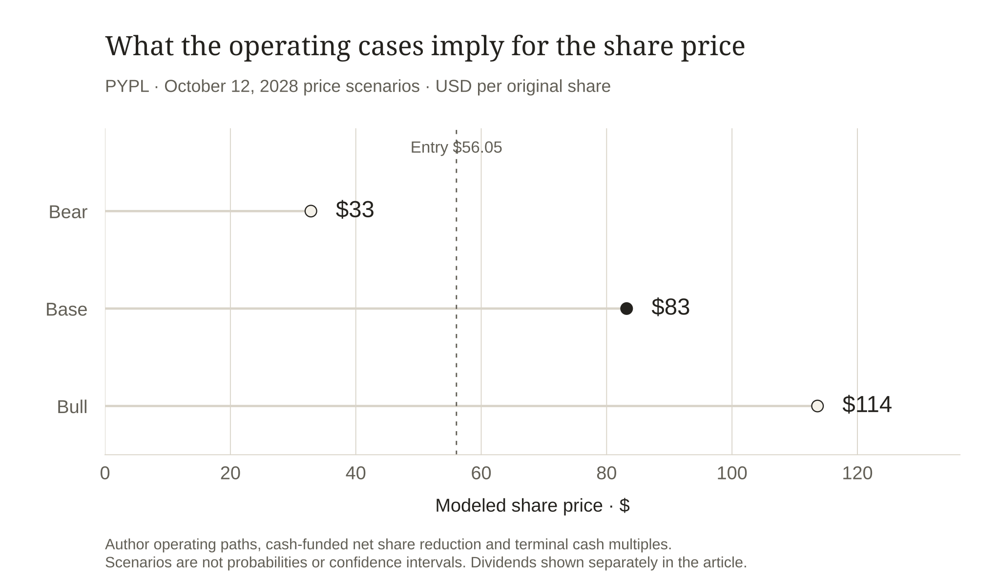

# PayPal: A Modest Recovery Worth Buying at $56

Written October 13, 2026; information/entry cutoff October 12, 2026.

I would buy PayPal at $56.05. My central forecast is **$85 by October 12, 2028**, roughly 52% above the entry price. I believe PayPal can become a better payments business through a modest recovery in transaction economics, more useful consumer products and disciplined retirement of shares.

The entry matters. Using a cash measure that charges employee equity and retained-loan investment, I am paying about ten times annual cash. My base case needs 4% sales growth, a small improvement in cash conversion and 5% annual net share retirement. It does not require a return to exceptional growth.

But the company has work to do. Faster payment volume has not translated into equally strong profit growth, and a smaller share count can disguise part of that weakness. The long depends on improving the business underneath the capital return. I want a recovery that can be checked in the financial statements.

## The opportunity is in better transaction economics

PayPal connects consumers and merchants through several businesses with different economics. Branded checkout, Venmo activity, unbranded processing and credit can all expand payment volume. They do not earn the same amount of contribution from each dollar moving through the platform.

That makes total payment volume a useful measure of activity and an incomplete measure of investment value. I care more about how much remains after processing expenses and transaction or credit losses, and how much is left again after the company supports its technology, customers and growth.

There are encouraging signs of deeper use. In Q2, currency-neutral branded online checkout volume grew 2%; Venmo volume grew 14%. Monthly active accounts reached 228 million, growing 1%, while transactions per active account excluding unbranded processing rose 7% on a trailing basis. Those figures suggest engagement can improve faster than the overall account count. They do not establish that the additional activity is highly profitable. [Q2 investor presentation](#source-p4)

My hypothesis is that repeated consumer use can make checkout more familiar, help merchants convert a purchase and create opportunities to earn from useful financial services. Better authentication and product execution may strengthen that loop. The investment test is paid contribution: users must return without incentives and losses consuming the value of their transactions.

I therefore want branded checkout growth to improve alongside contribution dollars. An accelerating low-margin processing business cannot, by itself, prove the consumer recovery. Nor can Venmo volume be relabeled revenue or added to overlapping branded-experience categories.

## The quarter explains why the valuation stays demanding

The Q2 arithmetic is more informative than its headline growth rate. Revenue rose from $8.288 billion to $8.682 billion. Yet transaction-margin dollars increased only from $3.844 billion to $3.900 billion. Non-transaction expenses on the company's adjusted basis rose faster, reducing adjusted operating income. [Q2 earnings release](#source-p3)

Only about 14 cents of each additional revenue dollar appeared in incremental transaction margin in this comparison. Lower losses helped, but processing costs absorbed much of the revenue increase. The expense budget then consumed more than the remaining increase. This is an accounting decomposition, not proof that one product caused every change.

There is a useful second view. Contribution excluding interest on customer balances increased by $93 million, while customer-interest revenue fell by $37 million. Together they explain the $56 million headline contribution increase. Watching the ex-interest measure makes the operating recovery easier to distinguish from changes in rates.

The company's 2026 plan still involves investment. It guides to approximately $15.6 billion of transaction-margin dollars and 7–8% growth in adjusted non-transaction expenses. Applying that midpoint to the previous annual cost base implies about $5.83 billion of adjusted operating income, versus $6.378 billion in 2025. The announced $1.5 billion gross saving target over two to three years cannot be added directly to future earnings; some savings fund new spending. [July IR newsletter](#source-p5)

I find the long attractive despite that near-term pressure because the price requires a manageable recovery. The forecast must still identify where the recovery occurs: contribution grows, investment becomes more productive and costs eventually increase more slowly than the value generated.

**Where the additional Q2 revenue went**

| Q2 year-over-year · $m | Change |

| --- | --- |

| Revenue | +394 |

| Transaction expense | +417 |

| Transaction/credit losses | −79 |

| Transaction-margin dollars | +56 |

| Adjusted non-transaction opex | +193 |

| Adjusted operating income | −137 |

The company's non-GAAP contribution/expense definitions reconcile the bridge. Arithmetic contributions do not establish product-level causality. [P3](#source-p3)

 [P3](#source-p3)](../figures/paypal-transaction-economics.svg)

Q2 reported-dollar payment volume and revenue grew faster than contribution excluding customer interest, while adjusted non-transaction costs grew faster still. [P2](#source-p2) [P3](#source-p3)

## The cash I am willing to value

Reported free cash flow is a starting point. PayPal also funds credit and pays part of its compensation in equity. I charge those uses before forecasting cash available for net retirement.

The latest full trailing year is built from FY2025 plus the first half of 2026 minus the first half of 2025. It produced $34.128 billion of revenue and $4.902 billion of GAAP net income. I preserve that full-year basis rather than extrapolating a strong quarter of cash collection. [FY2025 filing](#source-p1), [June 2026 filing](#source-p2)

The compensation deductions measure an economic burden, not an immediate cash expense. Charging the current capitalized amount also recognizes compensation used to develop software. The loan deduction recognizes cash deployed through investing activities into retained credit. Principal remains an asset that can be repaid; the deduction asks what cash was left for distribution after funding it.

At the entry and the 855.461 million shares disclosed for July 22, this proxy yields approximately 10.02% on a $47.949 billion equity capitalization. That dated share count is a public denominator, not an exact October count. I consider this the useful starting valuation because the cash measure reflects more of what the business asks shareholders to fund.

**Trailing cash bridge · USD millions · ending 2026-06-30**

| Measure | Amount · $m |

| --- | --- |

| Operating cash flow | 7,475.000 |

| Cash capital expenditure | −889.000 |

| Reported free cash flow | 6,586.000 |

| CFO-added stock compensation | −1,001.000 |

| TTM capitalized SBC | -128.000 |

| TTM retained-loan net investing | -653.000 |

| Cash underwriting anchor | 4,804.000 |

FY2025 + current comparable interim − prior interim. Compensation/normalizations are author sensitivities, not additional reported cash expenses. [P1](#source-p1) [P2](#source-p2)

 [P2](#source-p2)](../figures/paypal-cash-underwriting.svg)

Reported operating cash becomes a lower underwriting anchor after cash capex, compensation and labeled company-specific sensitivities. Matching trailing periods; USD billions. [P1](#source-p1) [P2](#source-p2)

## The larger cash headline needs reconciliation

PayPal's adjusted free cash flow removes timing between originating held-for-sale BNPL receivables and selling them. On a trailing basis it reaches $7.926 billion, versus reported FCF of $6.586 billion. The adjustment can clarify timing, but it does not eliminate credit losses, funding dependence or the economics of selling those loans. [Annual cash reconciliation](#source-p6), [first-quarter reconciliation](#source-p7)

The latest FY2026 adjusted-FCF guidance is $6 billion-plus. I do not make the larger trailing number permanent in the forecast. My stricter $4.804 billion anchor helps the long survive a less flattering cash interpretation.

The reverse problem can also occur: collecting or selling an existing loan book can improve cash while the opportunity to earn future credit revenue shrinks. A higher distribution number alone would not prove a healthier payments platform. I would reconcile it with contribution, retained-credit balances and the reported lending cash flows. This is why the $653 million historical charge stays visible as a sensitivity: future loan funding can differ, but an improvement caused by releasing capital should be distinguished from one caused by better recurring transaction economics.

The balance sheet also has distinct cash blocks. Liquid corporate cash and investments, excluding strategic investments, total $13.530 billion against $13.400 billion of debt. Customer assets are separate. The $13.667 billion customer-cash component in the cash-flow reconciliation is not additional shareholder liquidity, and even corporate balances support operations and regulation.

The filing permits designated European customer balances to fund credit within its Luxembourg banking subsidiary. The approved amount was $2 billion at June 30, with another $500 million approved in July; exceptional circumstances could call on corporate liquidity. These obligations explain why a large displayed cash balance is not automatically an excess-cash bonus. I add no such bonus to the valuation. [Liquidity and credit-funding disclosures](#source-p2)

## A modest recovery can fund meaningful net retirement

My base case grows consolidated revenue by 4% each year, from $34.128 billion to a $36.913 billion annual run rate near the horizon. Cash after compensation and retained-credit reinvestment reaches 14.5% of sales. The observed proxy is approximately 14.1%, so this assumes a modest improvement in conversion rather than a dramatic transformation.

The result is $5.146 billion of annual cash in the first model year and $5.352 billion in the second. I budget another $300 million annually for transformation and liquidity. I also assume the current $0.14 quarterly dividend persists, rather than treating future declarations as known.

Assumed average repurchase prices of $65 and $75 support 5% net retirement per year, or 9.75% across both years. Those are author inputs. Compensation replacement is charged before allocating the net-purchase budget; I am not calling every dollar of gross repurchases value creation.

The budget is deliberately more restrained than simply extending the company's $6 billion annual repurchase guidance. It leaves cash uncredited in the terminal price. If reinvestment, dividends or regulatory needs increase, net retirement must slow. Borrowing cannot be used to make an operating recovery appear stronger than it is.

**Base-case cash allocation and affordable net share reduction**

| Author model | Year 1 | Year 2 |

| --- | --- | --- |

| Revenue · $m | 35,493.12 | 36,912.84 |

| Cash after compensation/reinvestment · $m | 5,146.50 | 5,352.36 |

| Additional protected cash/debt budget · $m | 300.00 | 300.00 |

| Dividend cash budget · $m | 479.06 | 455.11 |

| Net share-purchase funding · $m | 2,780.25 | 3,047.58 |

| Compensation-replacement proxy · $m | 1,171.27 | 1,218.12 |

| Cash left after allocations · $m | 1,587.20 | 1,549.68 |

| Ending shares · millions | 812.69 | 772.05 |

Forward cash margins already charge economic compensation and company-specific reinvestment. Net purchases do not receive a second return credit. Forward owner-cash margins already include recurring retained-credit reinvestment and economic stock-compensation charge. $300m yearly additional transformation/liquidity budget; no customer-cash bonus. Dividend assumed held at $0.14 quarterly, not guaranteed.

## My $85 forecast and the valuation it requires

At the base case's ending share count, $5.352 billion of annual cash becomes $6.93 per share. Twelve times that amount gives **$83.19 in the model**. I register a rounded $85 central forecast, so the prediction is clear without suggesting the spreadsheet can identify a future price to the cent.

A separate 14% net-margin check produces about $6.69 of earnings per share. The exact cash valuation is approximately 12.4 times those earnings. This is a reasonableness check on the same business, not a second valuation to add.

The base model generates about 48.4% price appreciation; the rounded forecast implies about 52%. Keeping the entry cash multiple instead gives approximately $69.19, or a 23.5% gain. Operating cash and fewer shares therefore create part of the prospective return, while moving from roughly ten to twelve times cash creates the rest. My central estimate needs both.

The reverse hurdle is useful. With base retirement and a twelve-times multiple, $4.363 billion of annual cash would support a 10% annualized price return from $56.05. That is roughly 9.2% below the observed cash proxy. The calculation depends on its valuation and retirement assumptions; it does not mean a decline in cash is always harmless.

Under base operating assumptions, nine times cash gives about $62.39 and fifteen times gives $103.99. That range keeps me honest about how much the investment depends on future buyers recognizing the recovery.

**The cash hurdle for a 10% annual price return**

| Conditional author diagnostic | Value |

| --- | --- |

| Required horizon share price | $67.82 |

| Year 2 recurring cash required | $4,363.4m |

| Cash change vs current underwriting anchor | -9.2% |

| Recalculated ending shares | 772.053m |

Scale both annual owner-cash margins; retain base revenue growth, repurchase prices, commitments, dividends and terminal multiple. Recalculate affordable net share reduction. This is an author diagnostic, not a market forecast. The 10% hurdle is a choice, not a forecast for SPY.

## The contrary case deserves numbers

The bear case represents deteriorating economics alongside weaker demand. Annual cash falls to about $3.442 billion, retirement slows and the multiple contracts. A rounded $35 outcome would mean substantial loss despite continuing repurchases and the assumed dividend.

The bull case needs better monetization and cost productivity to raise cash to $6.135 billion. Six-percent retirement remains cash-funded, and the multiple reaches fourteen. Its roughly $115 rounded outcome is a plausible successful recovery, not an assigned probability.

The strongest concern is that checkout loses relevance while low-margin volume grows elsewhere. New products might require continual spending just to stabilize demand. Credit could use more capital or produce higher losses. In that situation, the attractive starting cash yield would shrink and repeated buybacks would retire a worsening earnings base.

**Operating and valuation cases · October 12, 2028**

| Author case | Year 2 cash · $m | Cash multiple | Model price | Price return |

| --- | --- | --- | --- | --- |

| Bear | 3,441.5 | 8× | $32.84 | -41.4% |

| Base | 5,352.4 | 12× | $83.19 | 48.4% |

| Bull | 6,135.4 | 14× | $113.64 | 102.7% |

Scenarios have no probability weights. Central forecast rounds the base model to $5. Dividend estimates are separate from price returns.

Bear, base and bull operating paths use affordable share reduction and explicit terminal cash multiples. Prices are author scenarios for October 12, 2028, without probabilities; dividends are separate.

## What would make me keep or change the view

By Q2 2028, I want trailing contribution excluding customer interest above $16 billion, branded-checkout volume growing at least 4% currency-neutral for two successive quarters, and monthly active-account growth above 2%. I also want the same strict cash measure above $5 billion, consistent with the base cash run rate. These are my forecasts, not management's guidance.

Two quarters of negative branded-checkout growth, trailing ex-interest contribution below $14 billion, or strict annual cash below $4 billion would materially weaken the long. Debt-funded capital return alongside those outcomes would make the interpretation worse. EPS growth alone would not rescue it.

Quarterly contribution and expense disclosures are the principal catalysts. I want to see savings become net operating leverage and consumer activity become profitable repetition. Under the unchanged-dividend assumption, eight future quarterly payments would add $1.12 per original share; realized distributions will be tracked separately from price performance.

**Dated operating predictions and conditions that change the long**

| Observation | Author test |

| --- | --- |

| By Q2 2028 | Trailing TM dollars ex-customer interest above $16bn; strict distribution-cash measure above $5bn |

| Consumer demand | Two quarters of branded-checkout TPV growth at least 4% currency-neutral; monthly active-account growth above 2% |

| Reconsider | Two negative checkout-growth quarters, ex-interest TM below $14bn, or strict annual cash below $4bn |

Use full comparable periods and the same cash definitions. These thresholds are author forecasts, not company guidance. Preserve the original price forecast when revising the thesis.

## My long thesis and dated forecast

I believe PayPal has enough distribution, useful products and existing cash generation to make a modest recovery valuable at this entry. My registered price prediction is $85 by October 12, 2028, judged against SPY over the same dates. I will preserve the original forecast when new evidence arrives. The opportunity is large enough without pretending the recovery has already happened.

## Evidence boundary

Public-source equity pitch written October 13, 2026, with information/entry-price cutoff October 12. Latest financial period: 2026-06-30. Latest disclosed shares: 2026-07-22; exact October shares/cash are not asserted. Author cash sensitivities, operating paths, purchase prices, valuation multiples and disconfirmation thresholds are labeled. Future accuracy is unobserved; no holdings or company work are implied.

## Sources

**P1 · [PayPal FY2025 Form 10-K](https://www.sec.gov/Archives/edgar/data/1633917/000163391726000024/pypl-20251231.htm)** · 2026-02-03

Annual cash flows, retained-loan investing and compensation; current non-GAAP EPS keeps SBC.

Reported facts, management guidance and author projections have different status; current share/cash dates remain explicit.

**P2 · [PayPal Q2 2026 Form 10-Q](https://www.sec.gov/Archives/edgar/data/1633917/000163391726000082/pypl-20260630.htm)** · 2026-07-28

Comparable H1 cash/earnings, dated shares, corporate/customer cash and Luxembourg credit-funding disclosures.

Reported facts, management guidance and author projections have different status; current share/cash dates remain explicit.

**P3 · [PayPal Q2 2026 earnings release](https://www.sec.gov/Archives/edgar/data/1633917/000163391726000080/pypl2q-26earningsrelease.htm)** · 2026-07-28

Transaction contribution, costs, payment volume, cash reconciliation and declared dividend.

Reported facts, management guidance and author projections have different status; current share/cash dates remain explicit.

**P4 · [PayPal Q2 2026 investor presentation](https://s205.q4cdn.com/875401827/files/doc_financials/2026/q2/PYPL-2Q-26-Earnings-Presentation.pdf)** · 2026-07-28

Branded/Venmo activity, guidance and capital return; overlapping TPV groups are not added.

Reported facts, management guidance and author projections have different status; current share/cash dates remain explicit.

**P5 · [PayPal Q2 2026 IR newsletter](https://s205.q4cdn.com/875401827/files/doc_financials/2026/q2/PYPL-2Q-26-Earnings-IR-Newsletter.pdf)** · 2026-07-28

Investment budget and gross savings; savings do not all become net profit.

Reported facts, management guidance and author projections have different status; current share/cash dates remain explicit.

**P6 · [PayPal FY2025 earnings release](https://www.sec.gov/Archives/edgar/data/1633917/000163391726000021/pypl4q-25earningsrelease.htm)** · 2026-02-03

Annual BNPL cash-flow reconciliation; timing adjustments do not remove credit economics.

Reported facts, management guidance and author projections have different status; current share/cash dates remain explicit.

**P7 · [PayPal Q1 2026 earnings release](https://www.sec.gov/Archives/edgar/data/1633917/000163391726000065/pypl1q-26earningsrelease.htm)** · 2026-05-05

Comparable interim adjusted cash reconciliation used in TTM bridge.

Reported facts, management guidance and author projections have different status; current share/cash dates remain explicit.

**P0 · [Alpaca SIP daily close · October 12, 2026](https://docs.alpaca.markets/reference/stockbars)** · 2026-10-12

Actual SIP daily bars and request parameters are frozen in the downloadable model bundle. This documentation link explains the bar schema; it is not a public display of the quoted close.

Daily close is the entry convention; no historical total-return adjustment is inferred. Corporate actions and distributions must be reconciled for evaluation.
