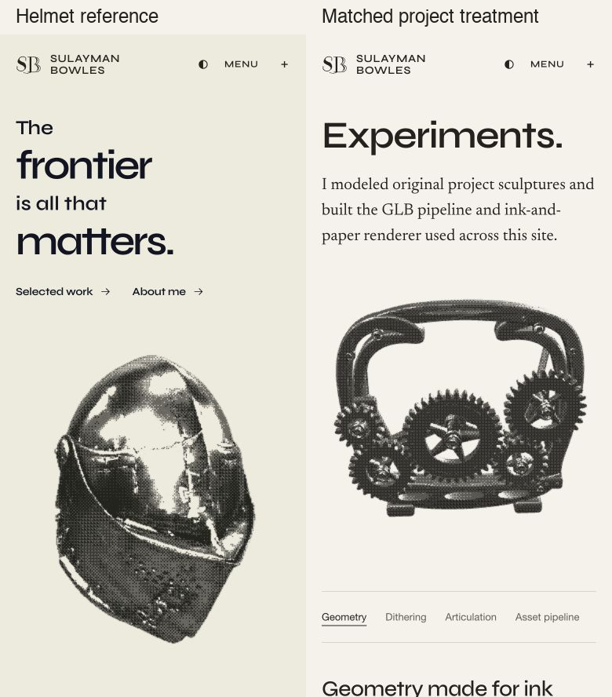
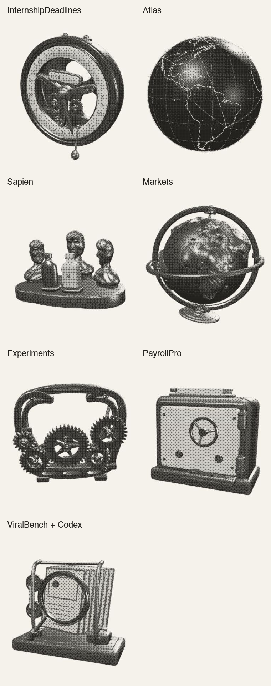

# Project sculpture render checks

These native browser captures show the approved helmet reference and final engraved treatment on all seven project sculptures. Captured October 13, 2026 at a 390×844 viewport on the verified implementation. Main’s newer centralized project summaries were preserved during pull-request integration; model bytes, artwork layout, print screen and rendering remain the captured version.

