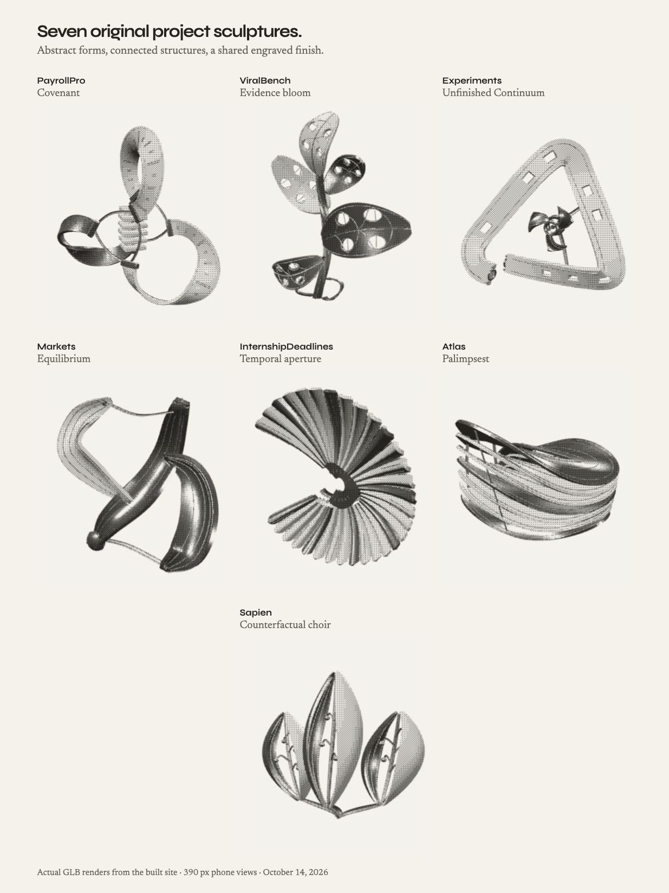

# Abstract project sculptures — October 14, 2026

The overview contains unchanged native captures of the final built GLBs at 390 × 844. Each artwork region is positioned at its original pixel size in a browser contact sheet. This is a render record, not generated concept art. All seven were also inspected at 1235 × 984, in rotated views and against the accepted helmet reference.

| Project | Sculpture | Construction |
| --- | --- | --- |
| PayrollPro | Covenant | Three open, engraved clasps join curved approval spines and fitted ferrules around an independently rotating terraced core. |
| ViralBench | Evidence bloom | Five unequal folded membranes contain twenty real windows; capillary traces split around the cuts and return to a common spine. |
| Experiments | Unfinished Continuum | A pierced cast path returns through three planes around a seated three-blade phase rotor. |
| Markets | Equilibrium | A sinuous load spine and two pinched pressure membranes enclose unequal voids, joined by tension bridges and tapered counterpoises. |
| InternshipDeadlines | Temporal aperture | Thirty-one lifted intervals grow around an interrupted spiral and a slow central index. |
| Atlas | Palimpsest | Seven open topographic strata share a stitched archive spine and expose their layered interior. |
| Sapien | Counterfactual choir | Three unequal split vessels reveal branching cores above a common braided root. |

These are original decorative sculptures. They do not depict measured results or a product interface. The accepted shader, helmet, physical print scale and manual interaction remain unchanged. Atlas now uses its own project GLB; the shared globe elsewhere remains intact.

Authoring: `node tools/build-project-sculptures.mjs`, with optional project slugs. The original case-model command delegates to this collection for PayrollPro and ViralBench. Source modules live in `tools/project-sculptures/`. Each compressed GLB carries its concept and original authorship; `public/portfolio-models/project-sculptures.json` records the exact hashes and validation. The seven assets total 2,571,536 bytes, use four to seven material batches apiece and contain 63,036–93,688 triangles.

Validation: 698 application tests and 19 bot-observer tests pass, as do application/API typechecks, client/SSR builds, 47 readable pages and the release/search gate. All sixteen registered GLBs pass compressed/decoded validation; source and built bytes match. Nine unrelated asset registrations/bytes are preserved. The actual geometry tests cover default, side/rear/polar and swept articulated framing. Native arrow rotation and Home reset pass for every new asset; pointer rotation and double-click reset pass on ViralBench. Light/dark engraving was inspected, and reduced motion settles the moving parts while retaining manual input.

The final built Experiments view advanced 1,633 frames in 54.449 seconds, approximately 29.99 fps. Its authored shaft quaternion changed. Warm CPU submission averaged 0.206 ms; main-thread task time was 1,135.695 ms including observation activity. GPU time and physical-device touch were not measured. Desktop/phone checks are browser viewport checks.

The optional unscoped legacy reoptimizer hit an existing glTF-Transform `weld` error on the untouched bass source. A read-only reproduction on that original source fails the same way. No unrelated model was rewritten. Direct collection generation, selected registry processing, sixteen-model verification and the complete release build pass; this pass does not certify unscoped regeneration of legacy about models in that local dependency runtime.

Native per-page captures, rotated views, interaction/cadence records, built-byte audit and exact command logs are retained in the task-owned ignored `.cache/project-sculptures-r8/`. The current implementation and inspection record is in `docs/project-clarity-20261012.md`, revision 8. Merge and production publication are separate from this review delivery.
