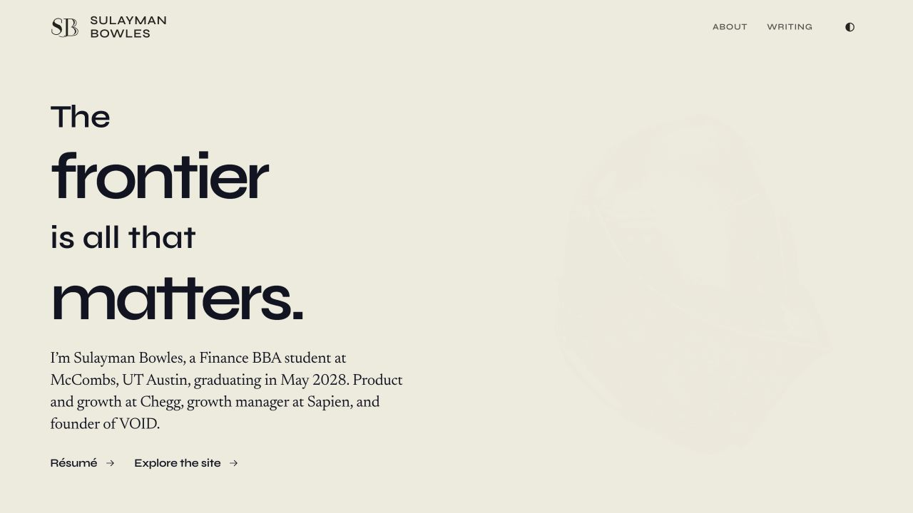
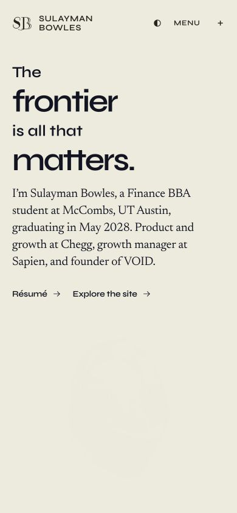

# Résumé and original recruiter landing — October 14, 2026

## Current brief and design authority

The human rejected a separate recruiter-page redesign and requires the original landing page with a short introduction: Sulayman Bowles, Finance BBA student at McCombs/UT Austin, expected graduation in 2028; product and growth at Chegg, growth manager at Sapien and founder of VOID. The original `HomePage` / `LandingSequence`, full-viewport paper/ink palette, Syne/Newsreader pairing, engraved helmet, later sculpture chapters and normal portfolio continuation are the design authority.

A first candidate added metrics, focus filters, curated evidence sections, a background disclosure and forwarding controls. That candidate is rejected. Its earlier design Pass claims, 58-test result, gallery and source-review bundle describe the rejected version and are superseded. Its source, test and work-record evidence remain in this task’s ignored `rejected-rebuild` archive. None of those modules or controls is part of the corrected candidate.

Root inspected the actual original desktop opening before restoring the recruiter wrapper. The corrected page uses the same original headline and layout, with only the requested biography and the existing résumé / site destinations. The ordinary `/` opening remains intact. Company metadata, exact-path identity, private/no-store responses, noindex, unknown/paused404 behavior and approved individual-link context remain compatible. The visible opening does not render a recipient greeting or job/application assumptions. Only the first paragraph of the ordinary readable homepage changes; its heading, navigation, profile, work, writing and footer remain byte-identical.

## Source ownership and retained résumé

Work occurs in this task’s isolated linked worktree, common Git owner `sulayman-personal-site-launch`, initially at `b9a5558c0d160ec1d844ba571017f68f6b264bd0`. Applicable AGENTS, project routes/current records, SULLY-DESIGN preferences, web-interface, validation and chosen-browser policies were read. Other top-level chats and dirty checkouts remain untouched.

The October12 corrected public profile and current PDF govern the résumé. Chegg / Internships.com owns scraper/data/search/SEO work; no independent InternshipDeadlines founder entry is added. Six real roles, Finance BBA expected May2028, the separate $50K+ collected at VOID and $100K venture revenue, awards, leadership, certifications and languages remain in the complete résumé. Current PDF SHA-256: `31ae4f352cf70208e948f648b9fff9d8c2d7b517d8f8c8fc70135047165021ef`. The original July PDF remains available as a historical artifact.

The résumé overview, six chapter pages and complete reading document use the accepted exact GLBs, readable type and consistent return controls. All six desktop/phone chapter views, All experience returns, full-document Contents, bottom return, Escape, loading fallback, pause and reduced motion were inspected in the prior résumé pass. Those résumé files are retained unchanged by the original-landing correction; their task-local receipts/captures remain under `visuals/final`. The accepted GLBs and helmet poster are already tracked and byte-identical to the starting baseline. No additional geometry or asset rewrite is part of this correction.

The older independent-founder attribution in the ordinary Work case-study source remains outside this landing/résumé change. No workbook/API-store write or recruiter communication occurs.

## Corrected-version evidence

- Focused check: Node24, `--experimental-strip-types --test --test-concurrency=1` with `outreach.test.ts`, `personalized-openings.test.ts`, `landing-heading-fit.test.ts`, `landing-sequence.test.ts`, `landing-opening-motion.test.ts`, `analytics.test.ts`, `route-scroll.test.ts`, and `resume-navigation.test.ts`: **77/77 pass**.
- Production build after integration onto current main: app/API TypeScript, Vite client, SSR renderer and 82 generated indexable pages plus404/discovery: **pass**.
- Release/search gate: **pass**, including current PDF bytes/label/date, 82 readable canonical documents, 82 direct redirects, 3014 asset references, discovery/CSP and exact package lock. The obsolete gate’s July-download-label assertion was updated because the download now points to the current résumé; the historical PDF existence check remains.
- Built HTTP check: **94/94 pass**, including all80company documents, IBM and sanitized individual aliases, ignored focus/query tampering, paused/unknown/malformed404s, HEAD, full native résumé, current PDF SHA and exact helmet bytes. All company bodies equal the ordinary homepage with only its first introduction paragraph replaced.
- Chosen in-app browser: **160 corrected opening views** at1280×720 and390×844, one desktop/phone pair for every company alias. Loaded original Syne, original headline, same plain biography and ready original helmet throughout. Zero overflow or clipped opening/actions; desktop actions end at672.23px, phone actions at505.68px. Actual captures and `page-checks.json` are retained under `visuals/original-restoration`.
- Actual navigation: opening résumé link reaches `/resume`; Read full résumé opens the complete document with all six roles, five sections, certifications and languages; Back to résumé restores the overview and button focus; native Back returns to the original company opening at its initial reading point. A locator click during a viewport resize initially scrolled the rail; fresh state and a native accessibility click resolved the automation timing and verified the real link.
- Post-integration repository gates: all `tests/*.test.ts` **722/722 pass** with one worker; bot observer **19/19 pass**; article presentation **28/28 pass**; article-quality and original-manuscript/asset integrity checks **pass**. Build/release and all94HTTPchecks were rerun against this integrated candidate. Local npm audit is unavailable because this host has the bundled Node executable without npm; the configured GitHub workflow runs the dependency audit.
- Actual script-disabled IBM individual arrival retains the plain introduction, readable ordinary homepage and native destinations. Reduced-motion IBM retains the original title/biography/helmet; all overrides were restored. Sustained original helmet motion was captured as162timestamped browser frames over5.97seconds, with no FPS/performance claim.
- `git diff --check`: **pass**. Localhost analytics remain inactive. Only sanitized local fixtures are used; no real recipient or application records were read.

The old gallery is historical. The corrected user-facing preview is the actual company landing route. No replacement review UI is added to the site.

| Design check | Result | Evidence |
| --- | --- | --- |
| Composition / brand | Pass | Original live composition compared with restored opening; added panels removed |
| Subject / craft | Pass | Original engraved helmet and later sculptures preserved; ready rendering in all160views |
| Typography | Pass | Original type hierarchy with a short readable biography; no heading/link clipping |
| Mobile | Pass | All80phoneopenings, visible actions and sculpture clearance |
| Interaction / loading | Pass | Actual résumé arrival/document/return plus retained prior complete chapter checks |
| Content readiness | Pass | Requested biography, October12 facts/currentPDF and preserved ordinary continuation |

These are root verification results against the original design authority, not human acceptance or production publication.

## Delivery boundary

The human authorized submitting an MR before this correction. Branch `codex/resume-original-landing-20261014` is rebased cleanly onto `origin/main` (`9d91621`), with only this task’s28source/review files. The three older unsquashed ancestor commits are already represented by main’s #93 and are excluded from the MR. Destination and GitHub actor are verified: public `SulaymanB2024/Portfolio_Site`, default/production branch `main`, authenticated actor `SulaymanB2024` with push permission. Source-owned check logs, capture/preview receipts and the final MR identity are retained in this task’s ignored cache. Submitted and attached [MR #102](https://github.com/SulaymanB2024/Portfolio_Site/pull/102), open for `main`, with the corrected28-file source diff and actual captures. GitHub verify and Vercel build are running; their current service results are available on the MR. Local checks above passed. Next boundary: review the MR; merging/deployment require separate authorization. No merge, deployment or unrelated-checkout integration is authorized.
