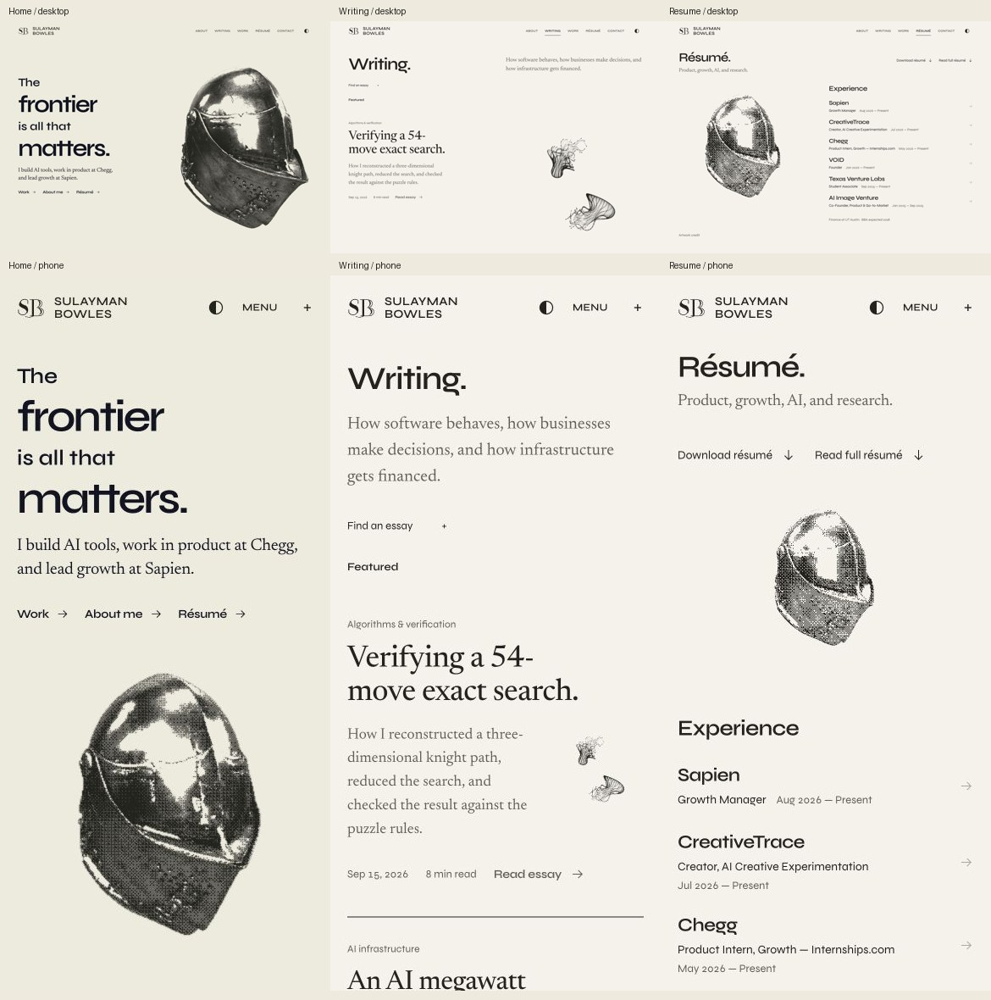
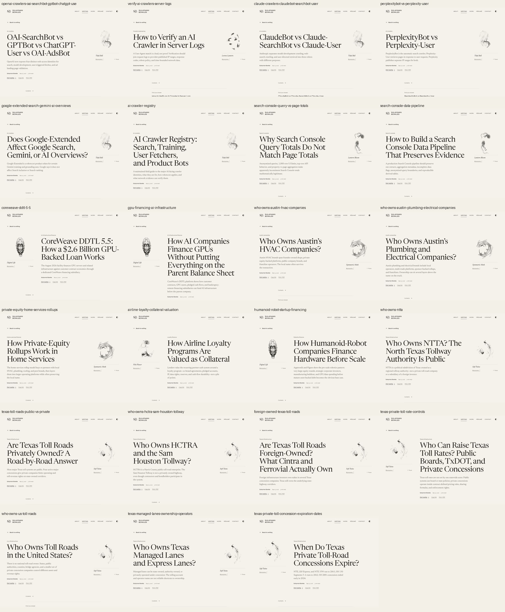

# Consolidated PR review — October 16, 2026

Current main already contains the print studio and nine research PRs. This review covers the combined résumé/navigation changes and all 23 newly restored September manuscripts, using the final local production build. No production merge or deployment is claimed.

## Checks

- 753 application tests, 19 bot-observer tests and 28 presentation/renderer tests passed.
- Application/API TypeScript and production build passed. Release/search gates passed: 107 canonical documents, 85 dated articles, 693 visible citations, 82 direct legacy redirects, 3,656 asset references.
- All 23 readers captured at 1280px and 390px, including complete bodies, figures/tables, sources, author endings and next reading. DOM readbacks show no page overflow or broken loaded images. Root inspected all eight review sheets.
- Both new wide tables expose keyboard-focusable scrolling regions; three Right-arrow presses moved each 120px without page overflow.
- Original heading plus synthetic 44-word worksheet copy fits desktop and phone. Actual pointer/Enter résumé links reach the native /resume document. Recruiter hash project arrival starts at zero; Back restores 1181.5px and Forward restores 844px.
- All six résumé chapter choices and returns, full-document Contents/return focus, current PDF destination, Writing query/reader/return focus, Contact pause/play and print-studio opening/form change/clean close checked.
- No production application console errors observed. Two old Vite client WebSocket errors followed intentional shutdown of the development server; the production preview has no Vite client.
- Frozen source comparison confirms all 23 records equal the exact #63 Git source blobs; all 62 existing article JSON files remain byte-identical to main.

## Design check

| Area | Result | Evidence |
| --- | --- | --- |
| Composition / brand | Pass | Retained paper/ink palette, Syne/Newsreader, original landing and existing authored artwork. |
| Subject / craft | Pass | Source-specific articles and retained attributed studies; no invented figures or factual updates. |
| Typography | Pass | All 23 desktop/phone openings and body crops inspected; long headings fit. |
| Mobile | Pass | 390px reader/UI inspection, no horizontal page overflow, accessible wide tables. |
| Interaction / loading | Pass | Native and hash navigation, history, filters/focus, résumé controls and retained studio exercised. |
| Content readiness | Pass for preserved dated editions | Original September text, source/verification dates and evidence boundaries retained; no October factual refresh claimed. |

Motion was visibly observed in the retained studies and Contact; no new motion asset or sustained frame-rate claim is made. Physical iOS/Safari and authenticated deployed preview inspection remain unverified.

## Every restored reader

| Article | Desktop | Phone |
| --- | --- | --- |
| [OAI-SearchBot vs GPTBot vs ChatGPT-User vs OAI-AdsBot](https://sulayman-bowles.dev/research/ai-crawlers/openai-crawlers-oai-searchbot-gptbot-chatgpt-user-adsbot) | [Full capture](readers/openai-crawlers-oai-searchbot-gptbot-chatgpt-user-adsbot-desktop.jpg) | [Full capture](readers/openai-crawlers-oai-searchbot-gptbot-chatgpt-user-adsbot-phone.jpg) |
| [How to Verify an AI Crawler in Server Logs](https://sulayman-bowles.dev/research/crawler-engineering/verify-ai-crawlers-server-logs) | [Full capture](readers/verify-ai-crawlers-server-logs-desktop.jpg) | [Full capture](readers/verify-ai-crawlers-server-logs-phone.jpg) |
| [ClaudeBot vs Claude-SearchBot vs Claude-User](https://sulayman-bowles.dev/research/ai-crawlers/claude-crawlers-claudebot-searchbot-user) | [Full capture](readers/claude-crawlers-claudebot-searchbot-user-desktop.jpg) | [Full capture](readers/claude-crawlers-claudebot-searchbot-user-phone.jpg) |
| [PerplexityBot vs Perplexity-User](https://sulayman-bowles.dev/research/ai-crawlers/perplexitybot-vs-perplexity-user) | [Full capture](readers/perplexitybot-vs-perplexity-user-desktop.jpg) | [Full capture](readers/perplexitybot-vs-perplexity-user-phone.jpg) |
| [Does Google-Extended Affect Google Search, Gemini, or AI Overviews?](https://sulayman-bowles.dev/research/ai-crawlers/google-extended-search-gemini-ai-overviews) | [Full capture](readers/google-extended-search-gemini-ai-overviews-desktop.jpg) | [Full capture](readers/google-extended-search-gemini-ai-overviews-phone.jpg) |
| [AI Crawler Registry: Search, Training, User Fetchers, and Product Bots](https://sulayman-bowles.dev/research/ai-crawlers/ai-crawler-registry) | [Full capture](readers/ai-crawler-registry-desktop.jpg) | [Full capture](readers/ai-crawler-registry-phone.jpg) |
| [Why Search Console Query Totals Do Not Match Page Totals](https://sulayman-bowles.dev/research/search-console/search-console-query-vs-page-totals) | [Full capture](readers/search-console-query-vs-page-totals-desktop.jpg) | [Full capture](readers/search-console-query-vs-page-totals-phone.jpg) |
| [How to Build a Search Console Data Pipeline That Preserves Evidence](https://sulayman-bowles.dev/research/search-console/search-console-data-pipeline) | [Full capture](readers/search-console-data-pipeline-desktop.jpg) | [Full capture](readers/search-console-data-pipeline-phone.jpg) |
| [CoreWeave DDTL 5.5: How a $2.6 Billion GPU-Backed Loan Works](https://sulayman-bowles.dev/research/financial-systems/coreweave-ddtl-5-5) | [Full capture](readers/coreweave-ddtl-5-5-desktop.jpg) | [Full capture](readers/coreweave-ddtl-5-5-phone.jpg) |
| [How AI Companies Finance GPUs Without Putting Everything on the Parent Balance Sheet](https://sulayman-bowles.dev/research/financial-systems/gpu-financing-ai-infrastructure) | [Full capture](readers/gpu-financing-ai-infrastructure-desktop.jpg) | [Full capture](readers/gpu-financing-ai-infrastructure-phone.jpg) |
| [Who Owns Austin’s HVAC Companies?](https://sulayman-bowles.dev/research/financial-systems/who-owns-austin-hvac-companies) | [Full capture](readers/who-owns-austin-hvac-companies-desktop.jpg) | [Full capture](readers/who-owns-austin-hvac-companies-phone.jpg) |
| [Who Owns Austin’s Plumbing and Electrical Companies?](https://sulayman-bowles.dev/research/financial-systems/who-owns-austin-plumbing-electrical-companies) | [Full capture](readers/who-owns-austin-plumbing-electrical-companies-desktop.jpg) | [Full capture](readers/who-owns-austin-plumbing-electrical-companies-phone.jpg) |
| [How Private-Equity Rollups Work in Home Services](https://sulayman-bowles.dev/research/financial-systems/private-equity-home-services-rollups) | [Full capture](readers/private-equity-home-services-rollups-desktop.jpg) | [Full capture](readers/private-equity-home-services-rollups-phone.jpg) |
| [How Airline Loyalty Programs Are Valued as Collateral](https://sulayman-bowles.dev/research/financial-systems/airline-loyalty-collateral-valuation) | [Full capture](readers/airline-loyalty-collateral-valuation-desktop.jpg) | [Full capture](readers/airline-loyalty-collateral-valuation-phone.jpg) |
| [How Humanoid-Robot Companies Finance Hardware Before Scale](https://sulayman-bowles.dev/research/financial-systems/humanoid-robot-startup-financing) | [Full capture](readers/humanoid-robot-startup-financing-desktop.jpg) | [Full capture](readers/humanoid-robot-startup-financing-phone.jpg) |
| [Who Owns NTTA? The North Texas Tollway Authority Is Public](https://sulayman-bowles.dev/research/financial-systems/who-owns-ntta) | [Full capture](readers/who-owns-ntta-desktop.jpg) | [Full capture](readers/who-owns-ntta-phone.jpg) |
| [Are Texas Toll Roads Privately Owned? A Road-by-Road Answer](https://sulayman-bowles.dev/research/financial-systems/texas-toll-roads-public-vs-private) | [Full capture](readers/texas-toll-roads-public-vs-private-desktop.jpg) | [Full capture](readers/texas-toll-roads-public-vs-private-phone.jpg) |
| [Who Owns HCTRA and the Sam Houston Tollway?](https://sulayman-bowles.dev/research/financial-systems/who-owns-hctra-sam-houston-tollway) | [Full capture](readers/who-owns-hctra-sam-houston-tollway-desktop.jpg) | [Full capture](readers/who-owns-hctra-sam-houston-tollway-phone.jpg) |
| [Are Texas Toll Roads Foreign-Owned? What Cintra and Ferrovial Actually Own](https://sulayman-bowles.dev/research/financial-systems/foreign-owned-texas-toll-roads) | [Full capture](readers/foreign-owned-texas-toll-roads-desktop.jpg) | [Full capture](readers/foreign-owned-texas-toll-roads-phone.jpg) |
| [Who Can Raise Texas Toll Rates? Public Boards, TxDOT, and Private Concessions](https://sulayman-bowles.dev/research/financial-systems/texas-private-toll-rate-controls) | [Full capture](readers/texas-private-toll-rate-controls-desktop.jpg) | [Full capture](readers/texas-private-toll-rate-controls-phone.jpg) |
| [Who Owns Toll Roads in the United States?](https://sulayman-bowles.dev/research/financial-systems/who-owns-us-toll-roads) | [Full capture](readers/who-owns-us-toll-roads-desktop.jpg) | [Full capture](readers/who-owns-us-toll-roads-phone.jpg) |
| [Who Owns Texas Managed Lanes and Express Lanes?](https://sulayman-bowles.dev/research/financial-systems/texas-managed-lanes-ownership-operators) | [Full capture](readers/texas-managed-lanes-ownership-operators-desktop.jpg) | [Full capture](readers/texas-managed-lanes-ownership-operators-phone.jpg) |
| [When Do Texas Private Toll-Road Concessions Expire?](https://sulayman-bowles.dev/research/financial-systems/texas-private-toll-concession-expiration-dates) | [Full capture](readers/texas-private-toll-concession-expiration-dates-desktop.jpg) | [Full capture](readers/texas-private-toll-concession-expiration-dates-phone.jpg) |

The article links identify canonical destinations prepared by this branch; source PRs remain open and these new destinations are not claimed as live on production. Exact source heads, per-PR dispositions and integration repairs are in [the work record](../../pr-bundle-20261016.md).
