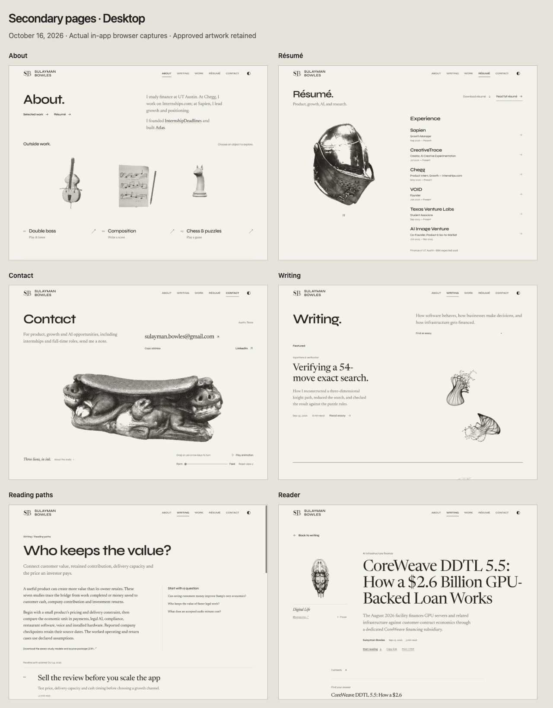
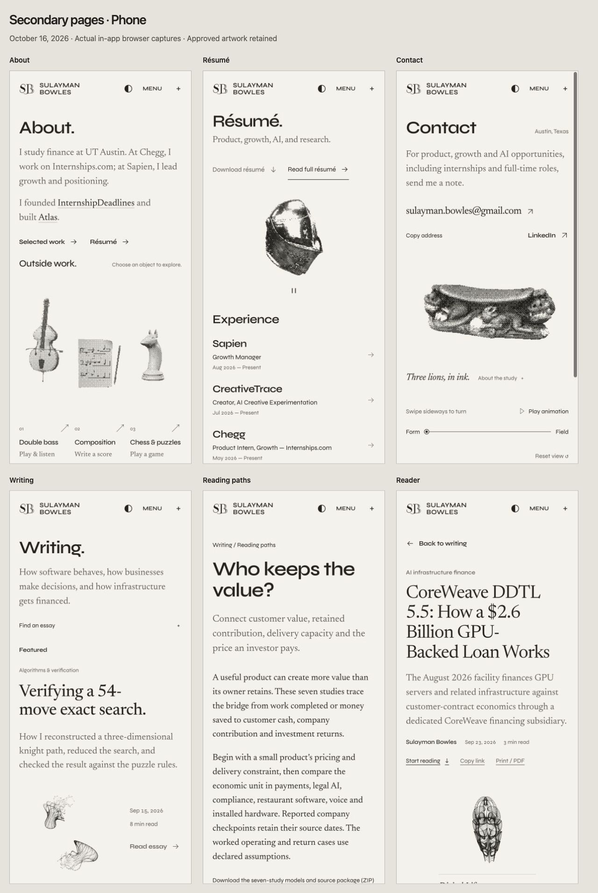

# Secondary-page design review — October 16, 2026

This pass refines About, Résumé, Contact, Writing, reading paths and shared readers against main `d300c44`. It was developed with **GPT-6.1 Sol** on editorial composition and **GPT-6 Astra** on About/résumé hierarchy, followed by root integration, independent cross-reviews and actual in-app browser inspection. MR #100 is already merged; this is separate review scope.

## Result

- About clearly introduces the three interactive objects and keeps their selector arrows and descriptions visible on phone. The first integrated phone render needed a 32px spacing correction; the final capture includes it.
- Résumé distinguishes the full document from the PDF download, gives all six roles a consistent organization/role/date hierarchy, and strengthens chapter navigation. The document, facts and artwork remain intact.
- Contact puts the email, copy action and LinkedIn before the live sculpture, with a readable invitation and controls at both sizes.
- Writing aligns discovery with its introduction and gives the phone lead essay a complete deck and larger artwork. Search, filters and empty results retain their existing behavior.
- Reading paths become an indexed directory; topic introductions and questions form a desktop briefing and a natural phone sequence.
- Reader covers and guides have more deliberate spacing. Phone continuations place artwork beside the deck under a full-width title; manuscript form distinctions remain intact.

## Inspect each family

The routes below are local review destinations, not claims of a production deployment. Raw captures are unedited browser output; the two overviews arrange those captures in a browser page. `captures.json` records their source filenames and SHA-256 hashes.

| Family | Local page | Desktop | Phone | Additional states |
| --- | --- | --- | --- | --- |
| About | [/about](http://127.0.0.1:4217/about) | [Opening](captures/about-desktop.jpg) | [Opening](captures/about-phone.jpg) | [Performances](captures/about-performances-phone.jpg), [ending](captures/about-ending-phone.jpg) |
| Résumé | [/resume](http://127.0.0.1:4217/resume) | [Opening](captures/resume-desktop.jpg) | [Opening](captures/resume-phone.jpg) | [Full desktop document](captures/resume-document-desktop.jpg), [full phone document](captures/resume-document-phone.jpg) |
| Contact | [/contact](http://127.0.0.1:4217/contact) | [Opening](captures/contact-desktop.jpg) | [Opening and controls](captures/contact-phone.jpg) | [Resize inspection and disposition](contact-resize-diagnostic.md) |
| Writing | [/writing](http://127.0.0.1:4217/writing) | [Opening](captures/writing-desktop.jpg) | [Opening](captures/writing-phone.jpg) | [Search](captures/writing-filtered-phone.jpg), [empty](captures/writing-empty-phone.jpg), [directory](captures/writing-paths-phone.jpg), [directory ending](captures/writing-paths-ending-phone.jpg), [page ending](captures/writing-ending-phone.jpg) |
| Reading path | [/topics/business-models](http://127.0.0.1:4217/topics/business-models) | [Opening](captures/topic-desktop.jpg) | [Opening](captures/topic-phone.jpg) | [Long introduction](captures/topic-long-phone.jpg), [ending](captures/topic-ending-phone.jpg) |
| Reader | [CoreWeave](http://127.0.0.1:4217/research/financial-systems/coreweave-ddtl-5-5) | [Opening](captures/reader-desktop.jpg) | [Opening](captures/reader-phone.jpg) | [Guide](captures/reader-guide-phone.jpg), [body/table](captures/reader-body-phone.jpg), [phone ending](captures/reader-ending-phone.jpg), [desktop ending](captures/reader-ending-desktop.jpg) |

All six settled résumé chapter openings are captured at both sizes: [Sapien](captures/resume-chapter-desktop-0.jpg) / [phone](captures/resume-chapter-phone-0.jpg), [CreativeTrace](captures/resume-chapter-desktop-1.jpg) / [phone](captures/resume-chapter-phone-1.jpg), [Chegg](captures/resume-chapter-desktop-2.jpg) / [phone](captures/resume-chapter-phone-2.jpg), [VOID](captures/resume-chapter-desktop-3.jpg) / [phone](captures/resume-chapter-phone-3.jpg), [Texas Venture Labs](captures/resume-chapter-desktop-4.jpg) / [phone](captures/resume-chapter-phone-4.jpg), [AI Image Venture](captures/resume-chapter-desktop-5.jpg) / [phone](captures/resume-chapter-phone-5.jpg). Additional reader forms: [model](captures/reader-model-phone.jpg), [notebook](captures/reader-notebook-phone.jpg), [proof](captures/reader-proof-phone.jpg).

## Verification

Commands use the existing bundled Node/runtime and dependencies. No test limits or product assertions were weakened.

| Check actually run | Result |
| --- | --- |
| `node --experimental-strip-types --test --test-concurrency=2 tests/*.test.ts` | **753/753 pass** |
| `node --import tsx --test packages/bot-observer/tests/*.test.ts` | **19/19 pass** |
| `node tools/test-article-opening.mjs` | **28/28 pass** |
| `node node_modules/typescript/lib/tsc.js --noEmit` | Pass |
| `node node_modules/typescript/lib/tsc.js --noEmit -p tsconfig.api.json` | Pass |
| Vite client build, Vite SSR build of `tools/render-public-site.tsx`, generated readable pages | Pass |
| `node tools/verify-release.mjs` including search gate | **107 canonical documents, 82 direct legacy redirects, 3,549 asset references; 85 dated feed entries and 693 citations** |
| `node tools/verify-article-quality.mjs` | Pass |
| `node tools/verify-restored-articles.mjs` | Pass |
| `node tools/texas-editorial.mjs check` | Pass |
| `git diff --check` | Pass |
| [Canonical HTTP audit](canonical-http.json) | **107/107** return 200 with exact canonical identity and readable heading |
| [Phone runtime catalogue audit](reader-runtime-phone.json) | **85/85** unique article readers mount with the expected heading/content, no page overflow and no broken loaded images; all seven forms represented |
| [Protected source/artwork audit](preservation-audit.json) | **123/123 tracked GLBs** match baseline/source/built hashes; all 85 manuscript records and protected profile, résumé, routing, renderer and shader sources unchanged |

The first full suite ran alongside builds/audits and passed 751/753: two unchanged Python model executions exceeded their 10-second limits. Their isolated seven-test rerun passed, followed by the complete **753/753** run at concurrency 2. The original failure and successful reruns are retained in the task cache; no test or timeout was changed.

Native interaction checks cover Contact copy confirmation and clipboard equality, pause/manual dispersion/reset; About selection/return focus, bass key input, composition add/undo, legal E2→E4 chess move and performance filter; all six résumé models in their settled state, next/previous/index/Escape and focus return, full-document Contents/section focus/return and current PDF href; desktop/phone Writing search/empty/clear and discovery Escape; reading-path question arrival and contextual return; article Start reading and Contents section focus. The unchanged homepage loads its original helmet. The complete Chegg→Sapien→VOID→Experiments project journey loads the approved sculptures and accepts arrow-key rotation/Home reset. [Project receipt](project-regression.json).

## Design check

| SULLY-DESIGN area | Status | Evidence |
| --- | --- | --- |
| Composition / brand | Pass | All six actual desktop/phone families inspected; paper/ink, Syne/Newsreader and original artwork retained. |
| Subject / craft | Pass | Existing authored sculpture studies, object relationships and article-form cover directions remain visible. |
| Typography | Pass | Clearer résumé hierarchy, full-width phone lead deck, separated topic title/deck and compact continuations; long reader titles inspected. |
| Mobile | Pass | 390px openings, discovery states, body/ending checks and complete catalogue width audit; 700px Contact boundary checked without overlap. |
| Interaction / loading | Pass for exercised states | Interaction checks above and unchanged asset/runtime sources; actual settled loading states captured. |
| Content readiness | Pass for preserved dated editions | Manuscripts, citations, source dates, profile facts, résumé/PDF and the four featured projects retain their accepted authority. |

The inspection is on the in-app Chromium preview, not a physical-device or new GPU-cadence benchmark. Some immediate Contact resize/reset captures were blank while its live field was changing; advancing rendered callbacks and later settled narrow/wide replays were verified, and the intact final form remains visible. The [diagnostic](contact-resize-diagnostic.md) records the exact observations and limits. No speculative renderer rewrite or claim covering every rapid mid-cycle resize was added. The preview has the existing task-owned, bounded lease; these committed captures remain available after it expires.

Independent reviews: [editorial direction](editorial-review.md), [profile direction](profile-review.md), [editorial cross-review](editorial-cross-review.md), [profile/Contact cross-review](profile-cross-review.md). Root rejected the proposed 700px Contact overlap finding using actual stage/caption geometry; the existing shared rule already resets its minimum height. The source-owned continuation record is [project-clarity-20261012.md](../../project-clarity-20261012.md).
