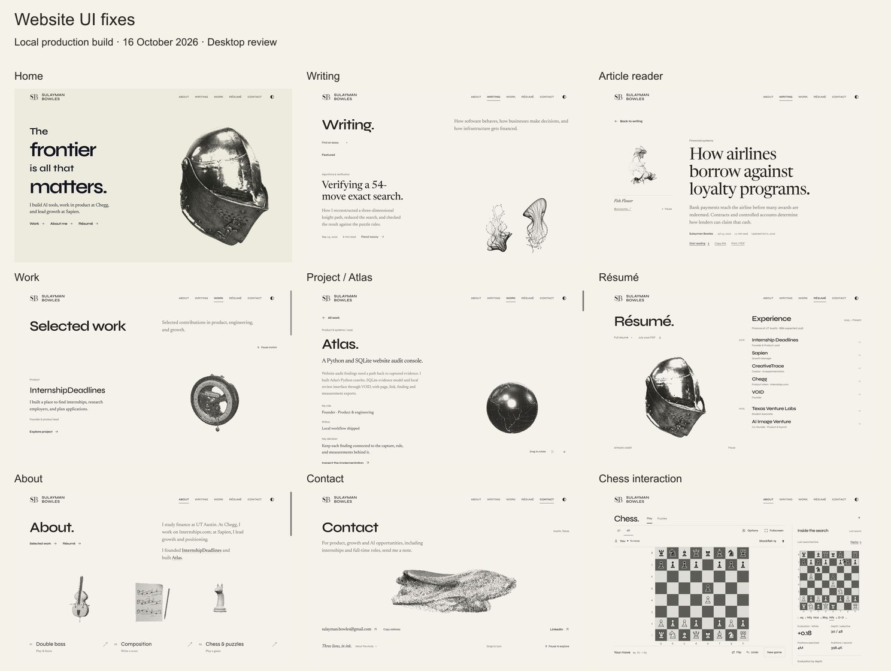
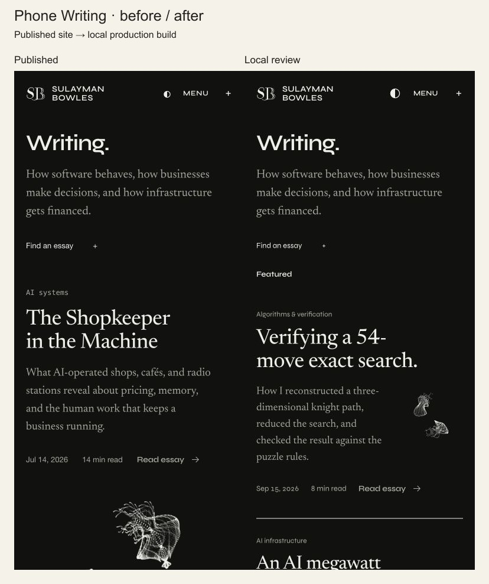

# Website UI review — October 16, 2026

Built from published main `9d91621` in isolated branch `codex/site-ux-20261016`. These are real CUA captures of the local production build, not design mockups. The first phone capture is the published site before the changes.

| Before | After |
| --- | --- |
| Home hides Work, Résumé and Contact in the desktop header. | The same five destinations are visible and keyboard reachable. |
| Phone Writing puts large artwork below every summary. | Full-width titles; 104px artwork beside the summary. |
| Curated and filtered collections use catalog order; dotted and ISO dates disagree. | Shared stable newest-first order, including filtered results; curated membership retained and labeled Featured. |
| Interface metadata mixes fallback sans and monospace faces; the theme glyph depends on font metrics. | Existing Syne/Newsreader roles throughout; literal code retains mono; centered SVG in the 44px theme target. |
| Contact waits four seconds before its first release. | Initial hold is 0.2 seconds; later holds and the original 36-second cycle remain. |

[Actual Contact motion recording](contact-motion.mp4) · [Phone reduced-motion state](contact-phone-reduced.jpg)

## Checks

- Node 24.19 `npm test`: **726 passed, 0 failed**.
- `npm run build`: **pass**, including application and API typechecks and 82 generated canonical documents.
- `npm run verify:search` and final `npm run verify:release`: **pass**, 62 feed entries, 617 citations, 82 legacy redirects and 3014 asset references.
- `npm run test:bot-observer`: **19 passed, 0 failed**.
- Focused curation regressions after independent review: **12 passed**. Mixed date formats, stable ties, complete membership, filtered ordering and input immutability covered.
- `git diff --check`: **pass**.
- Initial Writing HTML contains Featured and all 62 unique article links. Protected homepage, catalog and recruiter copy files match the baseline; header-only changes are visible in the diff.

In-app browser at desktop 1280×800 and phone 390×844; Writing additionally at 320×740. Reviewed Home, Writing, an article reader, Work, Atlas project, résumé/document, About/chess and Contact. No page-level overflow observed. Verified menu keyboard opening/Escape focus, search/topic/empty recovery, query and selected-link focus on return from an article, reader-start anchor, résumé document open/return, actual PDF download (byte-identical to shipped file), and Georgia print styling. Normal mobile art remains live; reduced motion shows a loaded poster. Browser error/warning log is empty.

Contact drag, arrows, manual dispersion, reset/resume and Copy address work. Cold reduced-motion Contact is intact and stopped. The clip preserves browser frame timestamps and shows the real opening/release; its 20fps encoding is not a physical-device frame-rate claim. About chess plays e4 → Stockfish e5 and replays the legal searched continuation without changing any of the 64 live square labels.

## Design check

| Check | Result |
| --- | --- |
| Composition / brand | Pass — original headline, palette, layout and artwork preserved; navigation is consistent. |
| Subject / craft | Pass — existing detailed studies retained; formed and dispersed Contact states inspected. |
| Typography | Pass — reading and interface roles match the existing brand; literal code and printed résumé keep their roles. |
| Mobile | Pass — 390px full flows and 320px Writing fit without page overflow. |
| Interaction / loading | Pass — readiness checked, actual controls exercised, reduced motion and console checked. |
| Content readiness | Pass for this UI patch — no manuscripts, dates, claims, career facts or recruiter copy changed. |

Local validation and PR delivery do not establish a production release. Separate project PR #100, résumé/recruiter PR #102 and the older review's copy/reader-order changes remain their own boundaries. Physical iPhone/Safari performance was not measured.

## Individual captures

| Surface | Desktop | Phone |
| --- | --- | --- |
| Home | [Open](home-desktop.jpg) | [Open](home-phone.jpg) |
| Writing | [Open](writing-desktop.jpg) | [Light](writing-phone.jpg) · [Dark](writing-phone-dark.jpg) |
| Article | [Airline reader](reader-desktop.jpg) | [Jane Street reader](reader-phone.jpg) |
| Work | [Open](work-desktop.jpg) | [Open](work-phone.jpg) |
| Atlas | [Open](project-desktop.jpg) | [Open](project-phone.jpg) |
| Résumé | [Overview](resume-desktop.jpg) · [Document](resume-document-desktop.jpg) | [Open](resume-phone.jpg) |
| About | [Open](about-desktop.jpg) · [Chess](chess-desktop.jpg) | [Open](about-phone.jpg) |
| Contact | [Open](contact-desktop.jpg) | [Normal](contact-phone.jpg) · [Reduced motion](contact-phone-reduced.jpg) |
