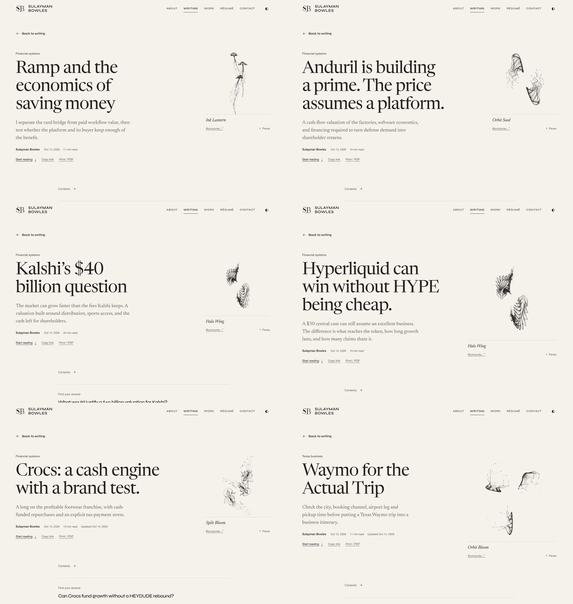

# Consolidated content QA — October 14, 2026

The combined branch includes the recent content PRs #94–#99 and their stacked #84/#88/#91/#92 history, together with the unregistered strategy/startup studies already present from #90. All 33 added or revised readers received full-body editorial/source review and native desktop/phone inspection. Original author positions, historical publication identities and frozen numerical forecasts are retained.

Scope was frozen at these source heads; a final open-PR inventory confirmed they had not changed:

| PR | Frozen head | Content |
| --- | --- | --- |
| #99 | `c538389219be8fa33baf2c396d4b459ddf458c1d` | Eighteen Texas investigations; includes #84/#88/#92 |
| #94 | `0fe7d470566d2d55a6dd5dd6df94a2e38293f057` | Adobe, PayPal, Crocs, Expedia and revised Chegg; includes #91 |
| #95 | `1a7a83775d54fdf784ae47904ac7453869b4a3f9` | Ramp, ElevenLabs, Flock and buyer calculators |
| #96 | `97320828eac67b6f5d9f958df5262fc3acd352b3` | Hyperliquid |
| #97 | `452d02e093e6e80be8bd3269122ca7b127cbe2df` | Kalshi |
| #98 | `475f788b100bc02ef14df9007f427200f1746c95` | Anduril |

Baseline main: `ed0d992825e1a4ee58914fc82f4459b0304034e0`. All six independent heads were merged with their histories. Shared catalogs, publication receipts, reader guides and artwork registries were integrated by identity, preserving both sides. The separate project-page UI PR #100, older UI #78 and September search expansion #63 are outside this recent-content consolidation. No original PR was manually closed and no production merge was performed.

No Stripe article, recent PR or remote content branch was found. Clarification was requested; Stripe has no claimed review or included manuscript.

## Findings repaired

- **Seven unreachable studies:** #90/#95 contained complete native bodies without public catalog registration. Added all seven routes, reader guides, attributed existing generative-art assignments, social cards, twelve authored figures, the business-models reading path and a reproducible source/model ZIP. The hosted Harvey/Vanta companion uses the reviewed five-file runtime and links back to the articles. Final share-card inspection caught Ramp title overlap; explicit reviewed line breaks fix it, with a reusable seven-card builder at `tools/build-business-model-share-images.mjs`. Hyperliquid's missing guide/presentation binding is supplied.
- **Kalshi invalid-state results:** clearing assumptions or entering a discount rate below terminal growth left earlier financial outputs visible. Invalid input now hides results and annual rows; valid input restores them. Actual browser QA also found that the reset button's `id="reset"` shadows `form.reset()`. Calling the native form prototype fixes reset. A VM regression reproduces that named-property collision and valid/invalid/reset transitions.
- **Planning-model boundaries:** the strategy model now rejects nonfinite, boolean, out-of-range and malformed assumptions and admits work within both commercial and delivery capacity. Its zero-work boundary is explicit. Investment CLI outputs cannot overwrite inputs through a normal path, symlink or hardlink. Toast's fixed 15% entry hurdle keeps its original meaning when a different selected hurdle is supplied. Canonical baseline outputs remain byte-identical.
- **Crocs missing scenario explanation:** the exporter assigned both scenario and reverse tables to one section, dropping the first. A separate source-bound section now displays bear/base/bull demand, cash, allocation and multiple assumptions alongside the unchanged $66.01/$165.30/$273.36 model prices. It distinguishes those operating scenarios from the separate tax-payment stress. Reproducible author export, reading time, receipt chain and downloadable article were updated; the original forecast registry and model inputs/results remain unchanged.
- **Harvey rounding:** prose now uses the same 36.2% ties-to-even display as the existing table for the 36.25% input. The numerical model was not changed; integration provenance records the correction.
- **Dated Texas update:** Waymo's actual [October 14 announcement](https://support.google.com/waymo/answer/18765688) opens San Antonio/SAT admission without an invitation. Only the two affected articles/ledgers were advanced, with append-only hash receipts and a new October 14 bundle. Austin booking/fallback instructions, freeway qualifications, older source checks and all three historical bundle URLs are preserved. The private Zoox preparation brief no longer asks the author to recreate a rejected allocated-cost figure.

## Editorial and analytical review

These reports preserve each independent lane's coverage, findings and source-access limits. The root inspected the actual reports, diffs, reproducers and results before acceptance. Initial findings in the frozen-edition reports are resolved by the changes above and the final checks below.

- [Seven strategy/startup studies](reviews/strategy-and-startups.md): all seven complete bodies, 24 tables and 46 sources; both Python planning/return models and the companion calculation logic. Twenty focused Python regressions and 42 companion tests passed. [Baseline parity](repaired-model-parity.json) is exact.
- [Three valuations](reviews/valuations.md): all 36 article sections, both implementations, inputs/results/CSVs and fifteen analytical figures. Independent accounting recomputation covers 45 Anduril annual rows, 30 Kalshi forecasts and 30 Hyperliquid discounted flows, with all fifteen explicit Hyperliquid product rows. Component tests include 24 Anduril Python checks, full Python/JS parity, reverse valuation and boundary scenarios. See [arithmetic receipt](valuation-arithmetic-checks.json).
- [Four longs and Chegg](reviews/long-pitches-and-chegg.md): all five complete bodies, table/figure/source consistency and the preserved positive Chegg stance. The author verification was freshly rerun against retained source snapshots: 93 source bindings, 552 arithmetic checks and 17 synthetic evaluator cases passed. These are not observations of future forecast performance.
- [Eighteen Texas studies](reviews/texas-research.md): all eighteen bodies and 224 ledger claims, 39 frozen source receipts, all fifteen scenario groups and executed-notebook/result parity. Independent arithmetic passed 117 scalar checks. Thirty targeted primary-record checks are documented with their limits. See [arithmetic receipt](texas-arithmetic-checks.json).
- [Final Texas integration audit](reviews/texas-october14-update.md): independently confirmed the narrow admission update, exact Austin paragraph restoration, unchanged freeway evidence, sixteen untouched article/ledger pairs, append-only receipt chains, historical bundle/model/notebook preservation and claims-only projection. See [preservation receipt](texas-preservation-checks.json).

## Browser and visual acceptance

Actual production-build browser inspections used the Codex in-app browser at **1280×900** and **390×844**. Every changed reader was opened at both sizes; figures were scrolled into view, all tables traversed, and openings/body exhibits/reader endings captured. The root visually inspected contact sheets of all changed openings, every analytical figure, first/last table views and reader endings. The new Crocs table received additional focused inspection and keyboard scrolling.

All 33 readers remained within the viewport; all inspected figures loaded and local source fragments resolved. Repeated settled checks recorded every phone opening at scrollY 0 and every desktop footer at the actual document bottom. Reduced-motion emulation was used for these settled receipts; ordinary-motion readers were inspected earlier. Theme, motion emulation and viewport overrides were restored after QA. No sustained-animation performance benchmark is claimed.

- [Per-reader coverage and capture hashes](reader-coverage.json), [phone readbacks](phone-openings.jsonl), [desktop readbacks](desktop-readbacks.jsonl), [corrected reader rechecks](corrected-reader-checks.jsonl).
- [Four collections at both widths](topic-readbacks.jsonl): seven business-model studies, eighteen financial readings, six autonomy investigations and twelve core Texas investigations; model/source downloads point to the intended artifacts.
- [Actual reader/model journeys](reader-and-model-journeys.jsonl): Ramp search → native reader → sources → ZIP → return to preserved search and card focus; Crocs keyboard table scrolling; buyer-model no-adoption/no-recurring-work/keyboard cases; Kalshi invalid/cross-field/reset/shock recovery; Hyperliquid scenario/invalid/reset recovery; Anduril margin delay, noncash compensation, reverse hurdles, invalid warning/reset and a downloaded fifteen-row CSV.
- The downloaded strategy ZIP matched the published bytes and was extracted afresh. All five model outputs reproduced byte-for-byte; 20 planning/return regressions and 42 companion tests passed from the extracted package. See [portable-model parity](portable-model-parity.json). Task-created download copies were then removed.

Selected actual screenshots are retained here; full reproducible captures remain in this task's local `.cache/content-qa/rendered` directory. Screenshot hashes identify those local captures, not a promise that every capture is checked into Git.

## Final local checks

| Command | Result |
| --- | --- |
| `npm test` | **721/721 passed**, no skipped/cancelled tests |
| `npm run test:bot-observer` | **19/19 passed** |
| `node tools/test-article-opening.mjs` | **28/28 passed** |
| `node tools/verify-article-quality.mjs` | **29 revised + 33 initial editions verified** |
| `node tools/verify-restored-articles.mjs` | **25 recoveries, 24 source revisions, 4 archives, 130 unchanged assets verified** |
| `npm run texas:check` | **18 articles, 194 dated sources; current public projection and receipt identities verified** |
| `npm run build` | **Passed**, including both TypeScript configurations; 82 indexable pages |
| `NODE_OPTIONS=--experimental-strip-types npm run verify:release` | **Passed**: 82 canonical documents, 82 legacy redirects, 3,014 asset references, 62 feed entries and 617 citations; CSP, discovery, metadata and lockfile gates |
| `git diff --check` | **Passed** |

Local runtime: Node 22.14.0 / npm 10.9.2. Node's npm HTTPS transport failed with EBADF; clean installation succeeded through a task-owned loopback transport to the official npm registry, with no lockfile/configuration change. The official npm bulk-advisory response contained one low-severity esbuild development-server advisory and no high/critical findings. CI uses its declared Node 24 runtime and the exact `npm ci` / `npm audit --audit-level=high` steps; the integration head `91e7dd594c0bb64c49ab935afa781514e3ee9b01` passed both Generated output integrity and Kalshi browser review. Provider log read-back explicitly confirms721/721 tests,19/19 bot checks,28/28 renderer checks and every publication/build/release gate. The final documentation follow-up is verified separately through the PR’s live exact-head checks.

## Evidence limits and delivery boundary

This review reads every changed manuscript and reproduces its declared arithmetic; it does not independently acquire every external citation. Fresh primary checks were targeted to controlling/material claims, with retained official source evidence reused where documented. Some Reuters pages, paid reports and fresh TAC rule bodies were inaccessible; those limitations are explicit in the lane reports and no unread source is treated as a fresh verification. Private-company cash, security preferences, token rights, actual route availability, project-specific legal/tax eligibility and future returns remain bounded by the published evidence and assumptions.

Delivery: [inclusive PR #101](https://github.com/SulaymanB2024/Portfolio_Site/pull/101), with [live submitted-head checks](https://github.com/SulaymanB2024/Portfolio_Site/pull/101/checks). Vercel reported a successful preview deployment. Its browser URL requires Vercel sign-in, so deployed UI inspection is not claimed; the complete browser acceptance above uses the local production build. The requested delivery is one inclusive PR. Production publication/merging remains a separate boundary. The source-owned work record is [docs/content-consolidation-qa-20261014.md](../../docs/content-consolidation-qa-20261014.md).
